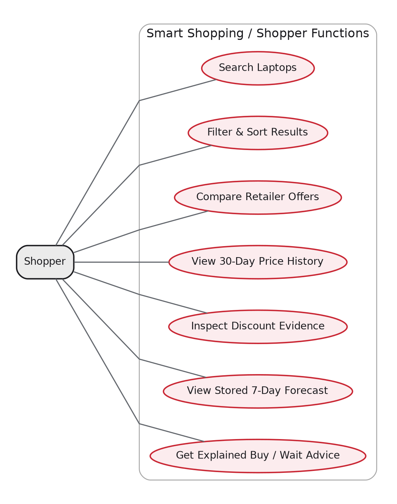
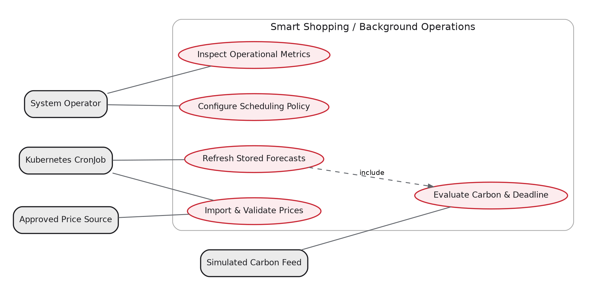
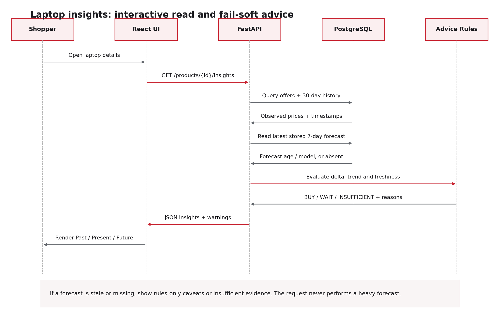
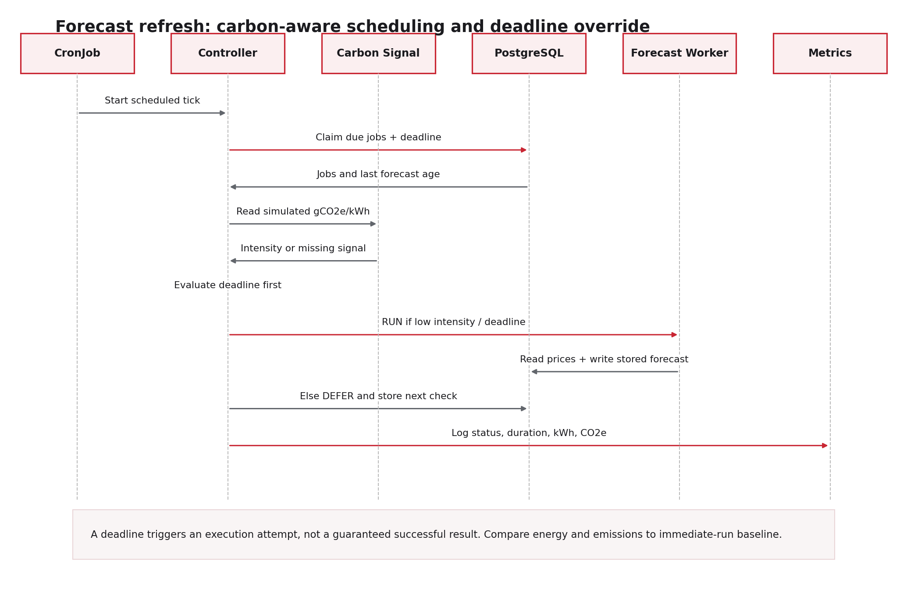
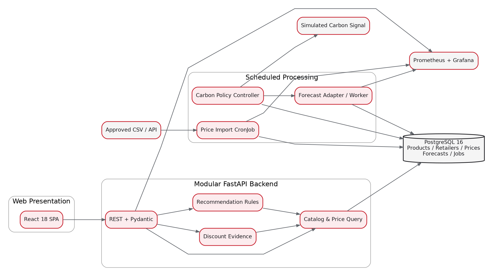
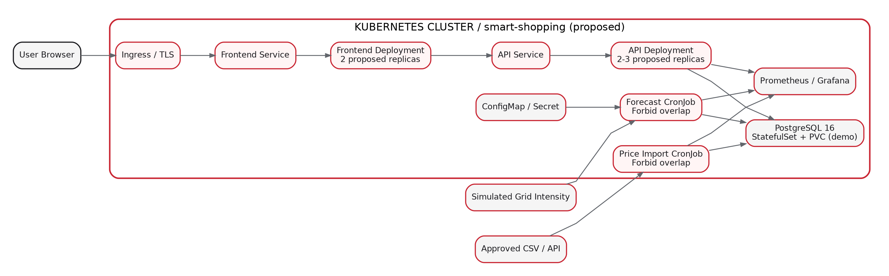

# Smart Shopping

**Price Analysis, Discount Prediction & Carbon-Aware Recommendations**  
**AACC - AI Architecture and Cloud Computing | Assignment 1: Architecture**

**Repository:** https://github.com/anchelesr/AACC-Smart-Shopping  
**Status:** Architecture proposal. The functions, performance targets and Kubernetes deployment described below are planned, not yet verified as implemented.

## Overview

Smart Shopping is a proposed web application for comparing **laptop** prices and making better-informed buying decisions. It brings together three perspectives:

- **Past:** 30+ days of observed prices and an evidence-based discount comparison.
- **Present:** current offers from multiple retailers, with timestamps and currencies.
- **Future:** a stored seven-day price forecast and an explainable **Buy Now / Wait / Insufficient Evidence** recommendation.

A second project goal is **carbon-aware cloud operation**: non-urgent forecasting jobs may be deferred during periods of higher *simulated* electricity carbon intensity, but not beyond their freshness deadline.

## Scope and Features

| Feature | Intended behavior |
| --- | --- |
| Laptop search | Search a small, indexed laptop catalog by name, brand or model. |
| Filtering and sorting | Filter by price and sort offers or results by price. |
| Retailer comparison | Display current observed prices, retailer, currency and collection time. |
| Price history | Show 30+ days of price observations and historical reference values. |
| Discount evidence | Compare current offers with a defined 30-day reference price; do not assert a retailer's official promotion. |
| Seven-day forecast | Display a pre-computed forecast with age, model identifier and limitations. |
| Shopping advice | Explain **Buy Now**, **Wait** or **Insufficient Evidence**, using available evidence. |
| Carbon-aware batch jobs | Read a simulated grid-intensity signal, execute or defer scheduled forecasts within deadline constraints. |
| Operations | Record service latency, job status, forecast age, estimated energy and estimated operational CO2e. |

**Outside the MVP:** user accounts, purchase checkout, payments, live web scraping, inventory reservation, retailer trust scores, email/push price alerts and physical-product lifecycle emissions. These may be future extensions, not current deliverables.

## Architecture

The system separates fast interactive requests from asynchronous price ingestion and forecast computation. A React frontend communicates with a modular FastAPI backend. PostgreSQL stores products, retailers, price observations, forecasts and job execution history. Kubernetes CronJobs run import and forecasting workloads; a carbon-aware policy determines whether a forecast should execute now or be deferred.

| Component | Role |
| --- | --- |
| React frontend | Search, charts, comparisons and recommendations |
| FastAPI service | Product API, validation, price queries, discount analysis and recommendation rules |
| Price import job | Validated, idempotent import from approved/CSV sources |
| Forecast batch job | Produces and stores forecasts using a replaceable, existing model/baseline adapter |
| Carbon policy | Applies simulated gCO2e/kWh and a maximum forecast-age deadline |
| PostgreSQL | Durable catalog, historical prices, forecasts and execution logs |
| Prometheus / Grafana | Planned operational and sustainability monitoring |

See [Architecture](docs/architecture.md), [Data Model and API](docs/data-model-api.md) and [Kubernetes Design](docs/kubernetes-design.md).

## UML Diagrams

The following images are previews. Editable **PlantUML source files** are supplied beside them.

### Shopper use cases

[PlantUML source](docs/diagrams/use-case-shopper.puml)

### Operational use cases

[PlantUML source](docs/diagrams/use-case-operations.puml)

### Shopping insights sequence

[PlantUML source](docs/diagrams/sequence-shopping.puml)

### Carbon-aware scheduling sequence

[PlantUML source](docs/diagrams/sequence-carbon-aware.puml)

### Logical component model

[PlantUML source](docs/diagrams/component-model.puml)

### Proposed Kubernetes deployment

[PlantUML source](docs/diagrams/deployment-kubernetes.puml)

The [Class Model](docs/diagrams/class-model.puml) and [Carbon Policy Activity Diagram](docs/diagrams/carbon-policy-activity.puml) are also supplied.

## Significant Use Cases

| ID | Scenario | Why it matters architecturally |
| --- | --- | --- |
| ASUC-01 | Import and validate price observations | Data provenance, unique records and repeatable jobs |
| ASUC-02 | View laptop offers, history and forecast | Interactive latency, stored forecasts and graceful fallback |
| ASUC-03 | Generate explainable buy/wait advice | Isolated decision rules and responsible handling of missing evidence |
| ASUC-04 | Refresh forecasts under carbon constraints | Asynchronous processing, deadline protection and carbon measurements |

[Detailed use-case specifications](docs/significant-use-cases.md)

## Carbon-Aware Scheduling

The proposed experiment uses a **simulated** carbon-intensity feed. Forecasts may be deferred above a **configurable demonstration threshold of 300 gCO2e/kWh**, unless the next freshness deadline would be violated. The forecast age objective is **at most 24 hours**. Due work is run even if intensity remains high; a missing signal triggers a documented fail-safe policy.

Operational emissions are **estimated**, not directly measured carbon emissions:

`Energy (kWh) = average power (W) * execution time (s) / 3,600,000`  
`Estimated emissions (gCO2e) = energy (kWh) * grid intensity (gCO2e/kWh)`

An immediate-execution baseline will be compared with the carbon-aware schedule under the same workload. Delaying a job does **not**, by itself, demonstrate lower total emissions. See [Verification Plan](docs/verification-plan.md).

## Proposed Technology Stack

React 18, Python 3.11+ with FastAPI, PostgreSQL 16, Pandas, a pre-existing forecasting adapter/baseline, Docker, Kubernetes, GitHub Actions, Prometheus, Grafana and PlantUML. These are design choices, not a claim of completed deployment. Course instructions do not call for custom model training or fine-tuning.

## Documentation

- [Project specification (FR and NFR)](docs/project-specification.md)
- [Architecturally significant use cases](docs/significant-use-cases.md)
- [Architecture overview](docs/architecture.md)
- [Relational data model and REST API](docs/data-model-api.md)
- [Kubernetes and carbon-aware implementation design](docs/kubernetes-design.md)
- [Architecture decisions (ADR-001 to ADR-006)](docs/adr/ADR-001.md)
- [Verification and sustainability benchmark plan](docs/verification-plan.md)
- [Course and review references](docs/references.md)
- [Changes from architecture review](docs/review-integration.md)
- [Assignment 1 PDF](Smart_Shopping_Assignment_1.pdf)

## References

The design is grounded in the AACC *Course Overview*, the *AI Architecture and Cloud Computing* lecture notes, relevant SE4AI architecture/requirements lectures and the supplied *Review Smart Shopping Technical Architecture* document. Targets and technologies taken from the review remain **proposed** until implementation and evaluation.
