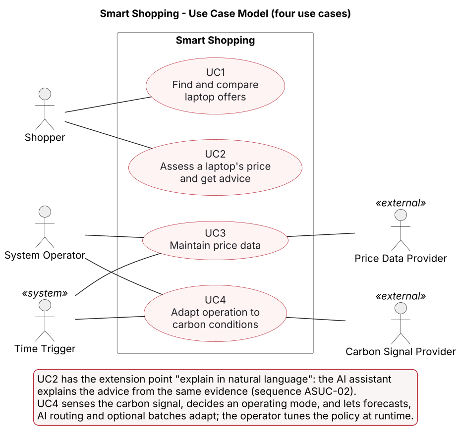
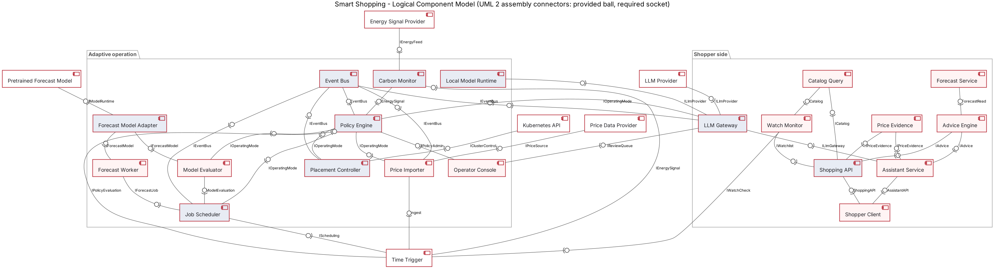
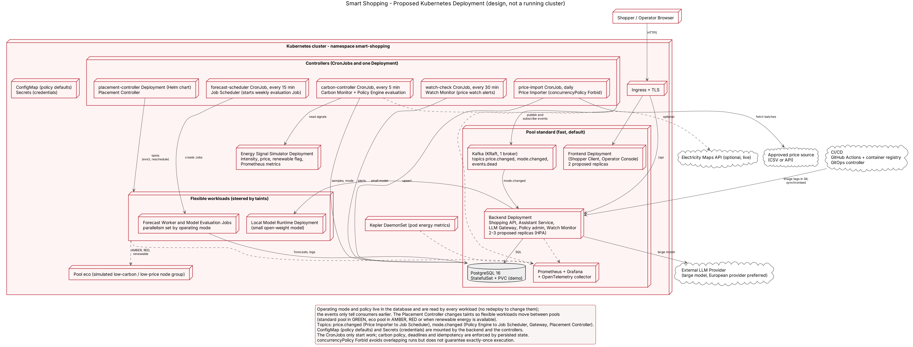

# Smart Shopping

**Price Analysis, Discount Prediction & Energy-Aware Recommendations**  
*AI Architecture and Cloud Computing (AACC)*

**Authors:** Linda Vincelová · Angelika Rischáneková  
**Repository:** https://github.com/anchelesr/AACC-Smart-Shopping  
**Revision 9** (final project, 25 November 2026): the system is deployable and operable (container image, Kubernetes manifests for a two-pool cluster, Prometheus and Grafana, a CI/CD pipeline, estimated carbon metrics with a reproducible experiment, dynamic redeployment and model exchange; see [docs/implementation.md](docs/implementation.md) and [deploy/README.md](deploy/README.md)). **Revision 8** (25 November 2026): revision 2 answered the course feedback, revision 3 integrated the lecture material, revision 4 refined the router, harness, agent decision, stakeholders and traceability, revision 5 added a working Kafka event bus, revision 6 synchronises the project with the supplied diagrams (price watch, budget constraints, supplementary sequences), revision 7 replaces the sequence, component and use-case diagrams with the new set (nine diagrams, a communication diagram added, comments moved from the images to the text). What changed and why: [feedback-response.md](docs/feedback-response.md), revision 8 implements the shopper path and the energy-adaptive control loop as running code (REST API, frontend, Carbon Monitor, Policy Engine, scheduler, forecast worker and evaluator, placement controller, LLM Gateway, price import, PostgreSQL; see [docs/implementation.md](docs/implementation.md)).

## What we are building

Buying a laptop involves more than finding the lowest advertised price. The same model appears in several shops, prices change from week to week, and a large percentage discount does not necessarily mean that an offer is unusually good. Smart Shopping shows three views of a laptop's price:

- **Past:** a dated price history and a clearly defined 30-day reference price;
- **Present:** comparable offers from different retailers, with source and observation time;
- **Future:** a stored seven-day forecast with its age and limitations.

It then gives a short **Buy Now**, **Wait** or **Insufficient Evidence** recommendation based on rules, and an AI assistant can explain that recommendation in natural language using only the evidence on the screen.

Two aspects make it an architecture project. The **AI components** (forecast model and assistant) are surrounded by a harness (routing, guardrails, caching, tracing, human review) and are evaluated before they are trusted. The **application adapts to simulated electricity signals** (carbon intensity, price, renewable share): it decides an operating mode, changes its behaviour and configuration at runtime and moves flexible workloads to an eco node pool, while a persisted deadline protects forecast freshness.

**Project status (revision 9):** the deployment files, the pipeline and the monitoring were written and statically validated in a sandbox without a cluster, a registry or GitHub Actions; **none of them has run for real**, and the eviction of the worker pod after a taint has never been observed. The exact list is in [docs/implementation.md](docs/implementation.md) ("Final project requirements: status"). The shopper path and the energy-adaptive control loop run as code: REST API and browser frontend, price import, Carbon Monitor, Policy Engine, Job Scheduler with leases and deadlines, Forecast Worker and Model Evaluator, Placement Controller, LLM Gateway (guardrails, router, cache, memory, trace, review queue, a stand-in local model) and the event bus, on SQLite and on PostgreSQL. In revision 9, 204 automated tests pass on SQLite (4 skipped) and 279 against a real PostgreSQL 16 (3 skipped). All data and signals are simulated and every threshold is a demonstration value. **Not verified:** a deployment on a real cluster, the four GitHub workflows (none has run), the Kafka integration tests, the `kubectl`, Ollama and Electricity Maps adapters against real systems, any load test or energy measurement (all energy values are labelled estimates). [docs/implementation.md](docs/implementation.md) lists what exists, how it was checked and every place where the code differs from the design.

## Scope of the first version

Laptops only, a fixed catalog of at least ten comparable models, three sample retailers and about 30 days of price observations (clearly labelled demonstration data). Out of scope: accounts, payments, email or push alerts, retailer trust scores, unauthorized scraping, and training or fine-tuning of our own models. The carbon estimate covers the application's computation, not laptop manufacturing or shipping.

## Use cases

Four use cases: find and compare offers, assess a price and get advice (with an AI explanation and a price watch with in-app alerts as extensions), maintain price data, and adapt operation to carbon and energy-price conditions. Three of them are architecturally significant and have sequence diagrams.



UC2 accepts an optional budget and brand preferences and then offers alternatives. Its two extensions are "explain in natural language" (the AI assistant, sequence ASUC-02) and "watch a price" (a device-scoped target price, a scheduled check and in-app alerts without email or push, sequence SQ-02). UC4 senses carbon intensity, electricity price and renewable availability, decides an operating mode and lets forecasts, AI routing, optional batches and workload placement adapt; the operator tunes the policy at runtime. The figure shows the four use cases with their included steps; [use-case.puml](docs/diagrams/use-case.puml) is the UML model of the same four use cases and two extensions, and the editable figure is [use-case.svg](docs/diagrams/use-case.svg).

[Use-case PlantUML](docs/diagrams/use-case.puml) · [Use-case SVG](docs/diagrams/use-case.svg) · [Significant use cases](docs/significant-use-cases.md)

## Sequence diagrams

Roles instead of technologies, numbered messages and visible self-calls.

| Use case | Diagram |
| --- | --- |
| ASUC-03 Maintain price data | [01-import](docs/diagrams/01-import.puml) · [SVG](docs/diagrams/01-import.svg) · [PNG](docs/diagrams/01-import.png) |
| SQ-01 Find and compare offers (supplementary) | [02-compare](docs/diagrams/02-compare.puml) · [SVG](docs/diagrams/02-compare.svg) · [PNG](docs/diagrams/02-compare.png) |
| ASUC-01 Assess a price: evidence | [03-analysis](docs/diagrams/03-analysis.puml) · [SVG](docs/diagrams/03-analysis.svg) · [PNG](docs/diagrams/03-analysis.png) |
| ASUC-01 Get advice with budget and alternatives | [04-recommendation](docs/diagrams/04-recommendation.puml) · [SVG](docs/diagrams/04-recommendation.svg) · [PNG](docs/diagrams/04-recommendation.png) |
| SQ-02 Watch a price and receive in-app alerts (supplementary) | [05-monitoring](docs/diagrams/05-monitoring.puml) · [SVG](docs/diagrams/05-monitoring.svg) · [PNG](docs/diagrams/05-monitoring.png) |
| ASUC-04 Adapt to energy conditions (overview of 04a to 04c) | [06-carbon](docs/diagrams/06-carbon.puml) · [SVG](docs/diagrams/06-carbon.svg) · [PNG](docs/diagrams/06-carbon.png) |
| ASUC-02 Explain the advice with the AI assistant | [07-ai-explanation](docs/diagrams/07-ai-explanation.puml) · [SVG](docs/diagrams/07-ai-explanation.svg) · [PNG](docs/diagrams/07-ai-explanation.png) |
| ASUC-04a to 04c in detail (kept) | [configure, sense, decide](docs/diagrams/detail/sequence-carbon-decide.puml) · [act and feedback](docs/diagrams/detail/sequence-carbon-act.puml) · [place workloads](docs/diagrams/detail/sequence-carbon-place.puml) |

Diagram 08 is a [communication diagram](docs/diagrams/08-communication.puml) of ASUC-01 ([SVG](docs/diagrams/08-communication.svg) · [PNG](docs/diagrams/08-communication.png)). The notes belonging to each diagram are in [significant-use-cases.md](docs/significant-use-cases.md) and [architecture.md](docs/architecture.md), below the images.

## Component model

A static UML 2 model with provided and required interfaces. Components are connected only through interfaces; the interface catalogue and the allowed-to-use specification are in [architecture.md](docs/architecture.md).



Each connector joins a provided interface (ball) to a required interface (socket); there are no plain arrows. Blue-grey = technical component (type T), pink = application component (type A), white = external system. Cross-cutting interfaces are listed in the interface table (docs/architecture.md) and not drawn: IDataAccess (Data Store) is required by Catalog Query, Price Evidence, Forecast Service, Watch Monitor, Forecast Worker, Model Evaluator, Price Importer, Carbon Monitor, Policy Engine, Job Scheduler, Placement Controller and LLM Gateway; ITelemetry (Telemetry) is required by Shopping API, Watch Monitor, Job Scheduler, Price Importer, Model Evaluator, Carbon Monitor, Policy Engine, Placement Controller and LLM Gateway; IOpsView (Telemetry) by Operator Console. IEventBus carries price.changed (Price Importer publishes, Job Scheduler consumes), mode.changed (Policy Engine publishes; Job Scheduler, LLM Gateway and Placement Controller consume) and events.dead (failed events). The database stays the source of truth (pull). Watch Monitor is called by the Shopping API (IWatchlist) and started by the Time Trigger (IWatchCheck).

[Component PlantUML](docs/diagrams/09-component.puml) · [SVG](docs/diagrams/09-component.svg) · [LLM Gateway structure](docs/diagrams/component-llm-gateway.puml) · [C4 context](docs/diagrams/c4-context.puml) · [C4 container](docs/diagrams/c4-container.puml)

## Carbon- and price-adaptive operation

The Carbon Monitor samples the simulated signals (carbon intensity, electricity price, renewable flag), the Policy Engine decides GREEN, AMBER or RED with hysteresis from the more restrictive signal, and every consumer reads the mode: forecast jobs, worker concurrency, assistant routing, cache lifetime and optional batches. A second layer, the Placement Controller, moves flexible workloads between a standard and an eco node pool. The operator edits the policy at runtime. The 24-hour job deadline wins in every mode, and the mandatory daily import is never shifted. Thresholds are configurable demonstration values; savings are to be measured against an immediate-run baseline. See [carbon-adaptation.md](docs/carbon-adaptation.md).

## AI architecture

The forecast model is inference only (a baseline plus one ready-made candidate behind an evaluation gate). The assistant sits behind an LLM gateway with an input guardrail, a router that scores the value of a call against its estimated cost (tokens, energy, carbon, electricity price) under the current mode and decides whether a call is made and which model (a local small one or an external large one) answers, with no agent (a fixed, bounded workflow), memory and cache, an output guardrail that checks every number against the evidence, a trace log and a human review queue. See [ai-architecture.md](docs/ai-architecture.md).

## Kubernetes and CI/CD

Frontend and a modular backend run as Deployments; carbon evaluation, job scheduling and import run as CronJobs; forecast workers and evaluation run as Jobs; a Kafka broker carries change events; Prometheus, Grafana and OpenTelemetry provide observability. Delivery uses GitHub Actions and GitOps. The application now has a `Dockerfile` and Kustomize manifests (`deploy/k8s`): the API, a forecast worker and a controller are Deployments of one image, PostgreSQL a StatefulSet, with Prometheus and Grafana beside them; the Placement Controller taints the non-target node pool through the Kubernetes API and the forecast worker (and an optional Ollama runtime) are evicted and rescheduled. Four GitHub workflows exist ([ci-cd.yml](.github/workflows/ci-cd.yml) is the main one) but none has run on GitHub. CronJobs for the scheduler and Kafka in the cluster remain design only. See [kubernetes-design.md](docs/kubernetes-design.md), [cicd.md](docs/cicd.md) and [deploy/README.md](deploy/README.md).



## Run the application

```
pip install -r requirements.txt
PYTHONPATH=src python -m shopping --demo --port 8080     # http://127.0.0.1:8080, operator token: demo-ops-token
python -m pytest -q                                       # add SHOPPING_TEST_POSTGRES=<url of a throw-away database> to test PostgreSQL too

scripts/demo-up.sh [--with-ollama]    # local kind cluster with a standard and an eco node (needs Docker, kind, kubectl)
scripts/smoke.sh                      # health, metrics, then a signal change that must taint a pool and move the worker pod
scripts/demo-scenario.sh              # the demonstration for the video
PYTHONPATH=src python scripts/carbon_experiment.py   # adaptive against immediate scheduling, writes docs/carbon-experiment.md
```

`--demo` loads synthetic prices and uses the simulated energy feed, so the operating mode follows the time of day. Configuration (database, Kafka, local and large model, operator token) is described in [docs/implementation.md](docs/implementation.md).

## Architecture decisions

| ADR | Decision |
| --- | --- |
| [001](docs/adr/ADR-001.md) | Modular backend with separate batch workers |
| [002](docs/adr/ADR-002.md) | PostgreSQL with provenance and durable operational state |
| [003](docs/adr/ADR-003.md) | Forecast model behind a replaceable adapter |
| [004](docs/adr/ADR-004.md) | Operating modes from a simulated carbon signal |
| [005](docs/adr/ADR-005.md) | Kubernetes resources by lifecycle |
| [006](docs/adr/ADR-006.md) | Show forecast age instead of silently serving stale advice |
| [007](docs/adr/ADR-007.md) | LLM gateway with router, guardrails, memory, cache and trace |
| [008](docs/adr/ADR-008.md) | Baseline and one ready-made candidate behind an evaluation gate |
| [009](docs/adr/ADR-009.md) | CI/CD with GitHub Actions and GitOps |
| [010](docs/adr/ADR-010.md) | Components defined by interfaces and an allowed-to-use specification |
| [011](docs/adr/ADR-011.md) | Batch prediction for forecasts, model-as-a-service for the assistant (proposed) |
| [012](docs/adr/ADR-012.md) | Publish-subscribe event bus (Kafka) on top of database state (accepted, implemented) |
| [013](docs/adr/ADR-013.md) | Two adaptation layers: behaviour and placement (proposed) |
| [014](docs/adr/ADR-014.md) | Observability and measured energy (proposed) |
| [015](docs/adr/ADR-015.md) | Route each assistant request by value and cost; small local model, large external model (accepted) |
| [016](docs/adr/ADR-016.md) | No autonomous agent: a fixed, bounded workflow (accepted) |
| [017](docs/adr/ADR-017.md) | Server-side price watch under a pseudonymous device identifier (proposed, implemented as an isolated module) |

## Documents

[Project specification](docs/project-specification.md) · [Significant use cases](docs/significant-use-cases.md) · [Architecture](docs/architecture.md) · [Energy adaptation](docs/carbon-adaptation.md) · [AI architecture](docs/ai-architecture.md) · [Data engineering](docs/data-engineering.md) · [Observability](docs/observability.md) · [Event bus](docs/event-bus.md) · [Implementation status](docs/implementation.md) · [Deployment](deploy/README.md) · [Carbon experiment](docs/carbon-experiment.md) · [Video script](docs/video-script.md) · [Synchronisation report](docs/sync-report.md) · [Distribution and dependability](docs/distribution-and-dependability.md) · [Data model and API](docs/data-model-api.md) · [Kubernetes design](docs/kubernetes-design.md) · [CI/CD](docs/cicd.md) · [Verification plan](docs/verification-plan.md) · [Traceability (stakeholder to test and metric)](docs/traceability.md) · [Feedback response](docs/feedback-response.md) · [AI usage log](docs/ai-usage-log.md) · [Review integration](docs/review-integration.md) · [Sources](docs/references.md)

Stakeholders have an influence, interest and priority, and conflicts between them are resolved by stated rules ([specification](docs/project-specification.md)).

The submission PDF is [Smart_Shopping_Assignment_1.pdf](Smart_Shopping_Assignment_1.pdf).

## Running the event bus

```
pip install -r requirements.txt
python -m pytest -q                                   # 68 tests without a broker
PYTHONPATH=src python -m events.demo                  # in-memory demonstration
docker compose -f deploy/docker-compose.yml up -d     # a local Kafka broker with the topics
KAFKA_BOOTSTRAP=localhost:9092 python -m pytest -q -m integration
KAFKA_BOOTSTRAP=localhost:9092 PYTHONPATH=src python -m events.demo
```

Code is in `src/` (`events`: event bus; `shopping`: API and frontend, importer, Carbon Monitor, Policy Engine, scheduler, forecast worker and evaluator, placement controller, LLM Gateway, advice, catalog, watch, database layer), tests in `tests/`, deployment files in `deploy/`. The audit of the supplied diagrams against the project is in [sync-report.md](docs/sync-report.md).

## Rendering the diagrams

The diagrams are PlantUML sources in `docs/diagrams`. The nine diagrams `01` to `09` have their `.svg` and `.png` next to the source; the other diagrams have their images in `docs/diagrams/previews` and the detailed carbon sequences are in `docs/diagrams/detail`. Render with `java -DPLANTUML_LIMIT_SIZE=8192 -jar plantuml.jar -tsvg docs/diagrams/*.puml` and `-tpng`. The use-case figure `use-case.svg` is generated by `docs/diagrams/tools/use_case_svg.py` and converted to PNG by `docs/diagrams/tools/svg_to_png.py`; `use-case.puml` is the UML model of the same use cases. A GitHub workflow checks that all sources still compile.

## Scope and limitations

The performance target (p95 ≤ 2 seconds at a defined 20 RPS), the freshness target, the energy thresholds, the availability target and the quality gates are **test criteria**, not results. A forecast, model or signal failure must not prevent display of stored prices while the database is available; a complete database outage would need an additional availability mechanism, which is not claimed here. The energy signals are simulated, the price thresholds are demonstration values, energy values are estimates with a documented method, and lower emissions are an outcome to measure.
