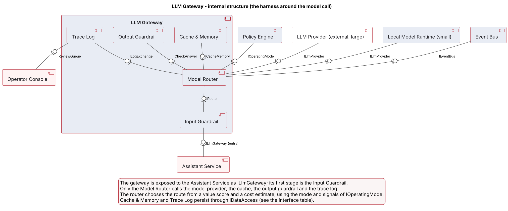

# AI architecture

The first revision treated the AI part as a single forecasting adapter. This document makes the AI components, their lifecycle, their harness and their evaluation explicit, using the course's vocabulary. Revision 3 adds the production side of the lifecycle (drift, live evaluation, shadow and staged release, rollback), the serving patterns and the local-first model hosting.

## AI components by type

| Component | Course type | Who trains it | What we build around it |
| --- | --- | --- | --- |
| Advice Engine, Price Evidence, all other application and technical components | Software 1.0 (programmed) | - | Tested conventionally. |
| Forecast model (baseline and candidate) | Software 2.0 (learned parameters) | Nobody on our side: the baseline has no parameters and the candidate is a ready-made model used as is | Adapter, data pipeline, backtest gate, sanity guardrail, drift monitor, registry. |
| Assistant model | Software 3.0 (LLM) | The provider | Gateway with router, guardrails, memory, cache, tracing, human review. |

The course scope excludes training or fine-tuning of our own models, so both AI components are *inference only* for us. What remains is the engineering around them, which is the larger part of the work.

## The lifecycle is a loop, not a line

The course describes ML development as six recurring stages that keep sending the team back: project scoping, data engineering, model development, deployment, monitoring with continual learning, and business analysis. Our version, without training:

| Stage | Our content | Document |
| --- | --- | --- |
| Scoping and framing | Goals, constraints, stakeholders; forecast framed as a regression from a 30-day series to seven prices; assistant framed as grounded explanation | [Specification](project-specification.md) |
| Data engineering | Sources, layers, validation, leakage rules | [Data engineering](data-engineering.md) |
| Model development | Baseline, one ready-made candidate, backtest gate | Section 1 |
| Deployment | Batch prediction for forecasts, model-as-a-service for the assistant | [ADR-011](adr/ADR-011.md) |
| Monitoring and continual evaluation | Live error, drift, shadow runs, rollback | Section 3 |
| Business analysis | Cost, tokens, energy and decision quality against the goals | [Observability](observability.md) |

## 1. Forecast model

### Lifecycle

| Stage | Our design |
| --- | --- |
| Data collection | Validated observations from the importer ([ASUC-03](diagrams/previews/sequence-import.png)); provenance kept. |
| Data integrity | Schema, positive amounts, comparable currency, unique observation identity. |
| Cleaning | One value per day: the lowest valid offer. A gap of up to 3 days is carried forward; longer gaps make the series ineligible and the job reports `insufficient_data`. |
| Features | The cleaned daily series of the last 30 days; no hand-built features are needed for the chosen models. |
| Training | None by us (see above). |
| Evaluation | Rolling-origin backtest: for several past origin days, forecast 7 days ahead and compare with the realised prices. Metrics: MAE and MAPE per laptop and in aggregate. |
| Inference | Background Forecast Worker job; result stored with model id and generation time. |
| Monitoring | When realised prices arrive, the error of each stored forecast is computed and compared with the baseline's error (rolling MAE); drift is tracked (section 3). |

### Models and the adoption gate ([ADR-008](adr/ADR-008.md))

- **Baseline:** repeat the last observed daily value for 7 days. It has no parameters, costs almost no energy and is always available.
- **Candidate:** one ready-made model, to be chosen during implementation among options that need no training by us, for example a pretrained zero-shot time-series forecaster or a classical method whose few parameters are estimated from each series at run time. We do not name a product here because the choice must follow the evaluation, not precede it.
- **Gate:** the candidate becomes the active model only if its backtest MAE is not worse than the baseline's. If its live rolling MAE is worse than the baseline's for three consecutive evaluations, the registry falls back to the baseline and the operator is notified. The operator can pin or roll back a model.
- **Limit:** with a synthetic 30-day fixture the backtest has few origins, so differences will often be within noise. The report must say so and must not claim accuracy that was not shown.

### Output guardrail

Before storing, the worker checks that every predicted price is positive and within a plausible band around recent prices (default: between 50 % and 200 % of the 30-day range). A failed check keeps the previous forecast visible with its age and marks the job failed for retry before the deadline.

## 2. AI assistant and its harness

The assistant explains the *existing* advice. It does not recommend, search the web, read other data or take actions: it is a read-only explanation layer over a structured evidence payload.

### Evidence payload and prompt design

The Assistant Service sends a JSON payload: laptop id, best offer with retailer and time, reference, delta, forecast summary and status, action, reasons and caveats. It is the only source of facts. Prompts are small and cohesive rather than one catch-all prompt:

1. **Intent classification** by rules (canned *explain the advice*, free-text follow-up, comparison, out of scope). A model is not needed here, which saves energy and removes one failure mode.
2. **Explanation prompt** with a fixed system instruction (explain only from the payload; no guarantees), the payload and the question, and a required output schema: `explanation`, `cited_facts[]`, `action_label`, `caveats[]`.

Prompts carry a version that is stored in the trace.

### Router and the decision "call a model or not" ([ADR-007](adr/ADR-007.md), [ADR-015](adr/ADR-015.md), FR-21)

The router decides *whether a model call is worth making at all* and which model answers. It works in four steps. Every number below is a configurable demonstration value, to be calibrated and tested.

**Step 1: hard rules** (first match wins). They protect safety and availability and cost nothing.

| # | Condition | Route | Why |
| --- | --- | --- | --- |
| 1 | Input rejected by the input guardrail | REFUSED | Out of scope or unsafe. |
| 2 | Cache hit | CACHE | No cost. |
| 3 | Evidence insufficient or advice is Insufficient Evidence | TEMPLATE | A model adds no information; the explanation is deterministic. |
| 4 | Provider unavailable, timeout, token budget exhausted or budget counter unreadable | TEMPLATE | Fault tolerance and cost control (NFR-04, NFR-18). |
| 5 | Mode RED | TEMPLATE | Energy saving; free-text questions get a notice. |

**Step 2: value score V (0 to 4).** The value of a model call is how much it adds beyond the template:

| Component | Points |
| --- | --- |
| Free-text question or comparison (a template cannot answer it) | 2 |
| Canned "explain the advice" question (a template exists, but the wording is better) | 1 |
| The advice carries caveats or conflicting evidence | +1 |
| Follow-up in the same session | +1 |

**Step 3: cost estimate per route.** For SMALL and LARGE the router estimates input tokens (measured from the payload), output tokens (the configured limit), the fee of the external model, the energy of the local model (calibrated Wh per token), gCO2e (energy times the current carbon intensity) and electricity cost (energy times the current price). The signals come from `IOperatingMode` (mode plus the latest intensity, price and renewable flag with their age). If a signal is missing the cost is logged as unknown and the mode alone decides.

**Step 4: required value by mode and cost caps.**

| Mode | SMALL (local model) | LARGE (external model) |
| --- | --- | --- |
| GREEN | V of at least 1 | V of at least 3, only after SMALL failed the output check, within the per-call cost cap and the share of the budget reserved for LARGE (demonstration: half of the daily tokens) |
| AMBER | V of at least 2 | Not allowed |
| RED | Not allowed | Not allowed |

A route whose cost estimate exceeds the per-call cap is downgraded one step (LARGE to SMALL, SMALL to TEMPLATE). A request that does not reach the required value gets the TEMPLATE answer. If a chosen model fails the output check twice, the answer is the template and the exchange is flagged.

| Example | V | GREEN | AMBER | RED |
| --- | --- | --- | --- | --- |
| Canned explanation, no caveats | 1 | SMALL | TEMPLATE | TEMPLATE |
| Canned explanation with caveats | 2 | SMALL | SMALL | TEMPLATE |
| Free-text question | 2 | SMALL, may escalate only if V reaches 3 | SMALL | TEMPLATE (notice) |
| Free-text follow-up with caveats | 4 | SMALL, then LARGE after a failed check | SMALL | TEMPLATE (notice) |

**Output of the decision.** Route, reason code, V, the cost estimate, the mode and the signal snapshot are written to the trace for every request, so a decision can be explained afterwards. The metrics are `router_decisions_total`, `router_value_score`, `assistant_estimated_cost_eur_total`, `assistant_estimated_gco2e_total` and `assistant_token_budget_remaining` ([observability](observability.md)).

**How it is evaluated.** A table-driven test covers every combination of V, mode, budget and provider state; a golden routing set checks the expected route; and one fixed set of questions is run through three configurations (always SMALL, always LARGE, the router) while recording tokens, estimated Wh, gCO2e, cost and the share of grounded answers. Nothing in this section is a measured result yet.

**Agent or not.** We do not deploy an agent; an agent is a language model with tools, and the fixed, bounded workflow of the gateway is enough. The criteria and the triggers for a later review are in [ADR-016](adr/ADR-016.md). The model phrases a result; it never decides.

### The harness at a glance

Everything around the model call is the harness. This table shows each part, where it lives and what justifies and checks it.

| Part | What it does | Component and interface | Requirements | ADR | Test (see [verification plan](verification-plan.md)) | Metric |
| --- | --- | --- | --- | --- | --- | --- |
| Input guardrail | Allow-list of topics, length limit, retailer text handled as data | Input Guardrail, `ILlmGateway` | FR-08, NFR-06 | 007 | Assistant groundedness, Security | `assistant_calls_total` (guardrail outcome) |
| Router | Value and cost gate, model choice, fallbacks | Model Router, `IRoute`, `IOperatingMode`, `ILlmProvider` | FR-13, FR-21, NFR-10 | 007, 015, 016 | Router value and cost | `router_decisions_total`, `router_value_score` |
| Token and cost budget | Daily token and compute budget | Model Router | NFR-18 | 015 | Cost control | `assistant_token_budget_remaining`, `assistant_estimated_cost_eur_total` |
| Cache | Exact answers keyed by evidence hash and mode class | Cache and Memory, `ICacheMemory` | NFR-01, NFR-18 | 007 | Assistant routing and trace | `assistant_cache_total` |
| Memory | Last five turns per anonymous session, 30 minutes | Cache and Memory, `ICacheMemory` | FR-08, FR-21 | 007 | Assistant routing and trace | `assistant_cache_total` |
| Model hosting | Small local model and external large model | Local Model Runtime, LLM Provider, `ILlmProvider` | NFR-07, NFR-18 | 015 | Fault tolerance | `assistant_tokens_total` |
| Output guardrail | Schema, numbers present in the payload, label equals the rule result, no guarantees | Output Guardrail, `ICheckAnswer` | FR-08, NFR-11 | 007 | Assistant groundedness | `assistant_calls_total` (guardrail outcome) |
| Logging and tracing | One record per exchange, one trace id from request to model call | Trace Log, `ILogExchange`, `ITelemetry` | NFR-14, NFR-08 | 007, 014 | Assistant routing and trace, Monitoring | `assistant_tokens_total`, `assistant_estimated_energy_wh_total` |
| Human review | Flagged exchanges to the operator, decisions extend the golden set | Trace Log, Operator Console, `IReviewQueue` | FR-17 | 007 | Assistant routing and trace | `review_queue_open` |

### Model hosting and sampling

The SMALL route calls an open-weight model hosted in the cluster (Local Model Runtime); the LARGE route calls an external provider, preferably European. Both sit behind `ILlmProvider`. The local runtime is a flexible workload and is relocated by the Placement Controller. Language-model output is non-deterministic and creativity is the same mechanism as hallucination, so we use temperature 0 with fixed sampling settings, store them with the prompt version, and cache exact answers; this makes behaviour as repeatable as the hardware allows. Tokens are a budget item (input tokens are cheap, output tokens expensive), and the context window is kept small by sending only the evidence payload and the last five turns.

### Guardrails

| Stage | Checks | On failure |
| --- | --- | --- |
| Input | Length limit; scope rules; product and retailer text wrapped as data and stripped of instruction-like patterns. | REFUSED with a template message. |
| Output | Schema valid; every number, currency and date appears in the payload (within rounding); `action_label` equals the rule result; no guarantee wording such as "will definitely"; answer language equals the question language. | Retry once with the error message added to the prompt (loop engineering); after the second failure, use the template answer and flag the exchange. |

The input guardrail uses an **allow-list** of topics (laptop prices, evidence, advice, comparison) instead of a block-list of forbidden ones, and the system instruction forbids unrelated tasks, otherwise a shop assistant is used for homework at the shop's cost. Retailer-supplied text is untrusted: it can contain instructions. Treating it as data, giving the model no tools and checking grounding on output limit the damage of such prompt injection; they do not remove the risk, which is why flagged exchanges go to a human.

### Memory and cache

- **Session memory:** the last five turns per anonymous session id, stored server-side for 30 minutes. No personal data is collected.
- **Exact cache:** key = intent, laptop id, evidence hash and mode class; lifetime follows the mode (5, 30 or 60 minutes). A new observation changes the evidence hash, so a stale answer cannot be served after the data changed. A semantic cache is not used in the MVP.

### Trace log and human in the loop

Every exchange is logged: request id, route and the reasons for it, model id, prompt version, tokens in and out, latency, guardrail outcome, estimated energy, operating mode and whether it was flagged. The log is the evidence for NFR-14 and for the energy comparison.

People are in the loop in three places: the operator reviews flagged answers and the decision extends the evaluation set (FR-17); the operator edits the carbon policy and overrides the mode (FR-12); the operator can pin or roll back the active forecast model. The shopper always sees a label: *AI-generated explanation based on the evidence shown*, *simplified explanation* or *not answered*.

### Evaluation (NFR-11)

A golden set of at least 30 cases is created from the fixture: canned explanations, follow-ups, comparisons, insufficient-evidence cases, out-of-scope questions and injection attempts embedded in product names. Measures: share of answers with all numbers grounded, action-label agreement, refusal correctness, template fallback rate, and route shares by mode. The same set runs in the pipeline ([CI/CD](cicd.md)) with a capped model budget.

## 3. Production lifecycle: drift, live evaluation, release and rollback

**Version everything.** Code, prompts, sampling settings and model identifiers carry versions that are stored with every forecast and trace, so it is always known which version produced which answer.

**Continued evaluation loop.** Log the prediction, wait for the ground truth (the realised price, which arrives within seven days), compute the metric, compare with a trigger, act:

| Step | Our implementation |
| --- | --- |
| Log predictions | `forecast_runs` with model id, generation time and inputs hash |
| Capture ground truth | Realised daily lowest prices from later imports (late but free of labelling cost) |
| Compute metrics | Per-forecast absolute error, rolling MAE per model, error on days with large moves |
| Trigger | Live MAE worse than the baseline for three consecutive evaluations, or a drift score above a limit |
| Act | Fall back to the baseline, notify the operator, queue an out-of-schedule evaluation. **We do not retrain**; training is out of scope, so the action is replace or fall back, not retrain. |

**Drift.** Models decay when the world or the data changes. We compare a *current window* of daily lowest prices with a *reference window* (for example the last 7 days against the 30 days before) per laptop, and record a score and the shape: **sudden** (a price cut), **gradual**, **incremental** (small steady steps that thresholds miss) or **recurring** (seasonal promotions such as Black Friday, which a naive detector would keep flagging). Rule-based checks come first; a statistical test such as Kolmogorov-Smirnov is optional. Short windows react fast and long windows catch slow drift, so two window sizes are used. A drift flag is shown to the operator and to the advice rules as a caveat; it is not an automatic action.

**Release strategies for AI changes.** A new candidate model, prompt or small model is released in this order, each step with a gate and a rollback:

1. **Gate before promotion:** backtest or golden-set evaluation against the current version, including a check that the result is not suspiciously perfect (a leak).
2. **Shadow deployment:** the new version runs on the same inputs and its outputs are stored with `shadow = true` and never shown; errors and cost are compared with the live version when ground truth arrives.
3. **Staged rollout:** 5 %, 25 %, 50 %, then 100 % of sessions (assignment is sticky per session, randomised and never by country, which would bias the comparison), each stage with a metric check.
4. **Rollback:** the operator pins the previous version at any time (`PUT /ops/model/active`); a rollback must always be possible, because a better result in tests is not a guarantee in production.

A/B tests with fixed sample size and duration, bandits and contextual bandits are known alternatives; we do not use them because the number of users in the demonstration is too small for significance.

**Consensus and coordination.** The model infrastructure sits on cluster managers that rely on etcd (Raft); we use Kubernetes and do not run consensus ourselves ([Distribution and dependability](distribution-and-dependability.md)).

## Risks

| Risk | Mitigation |
| --- | --- |
| Hallucinated facts | Payload-only facts, output grounding check, template fallback. |
| Prompt injection through product text | Data wrapping, no tools, grounding check, human review of flagged answers. |
| Cost and energy of model calls | Router, cache, budget, RED mode, trace of estimated energy. |
| Provider outage or model change | Gateway isolates the provider (NFR-07); template fallback (NFR-04). |
| Forecast no better than the baseline | Gate and live comparison keep the baseline active. |
| Drift (promotions, price cuts, new models) | Reference and current windows, shape classification, caveats, shadow runs, rollback. |
| Non-deterministic model behaviour | Temperature 0, fixed settings, exact cache, no model in any control loop, no agent. |
| Token cost grows | Router gate, local small model, budget (NFR-18), dashboards. |
| Over-trust in advice | Labels, caveats, ages shown, no guarantee wording. |
