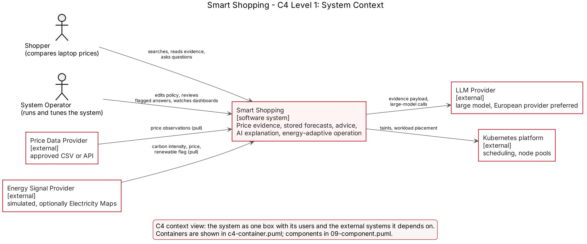
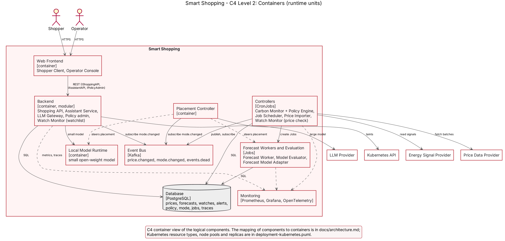
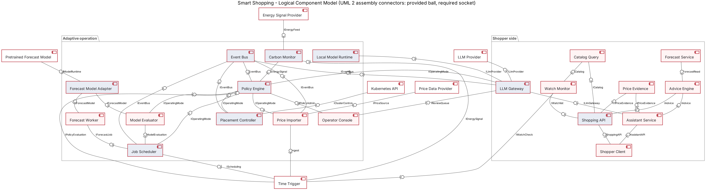
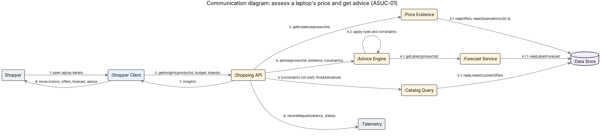
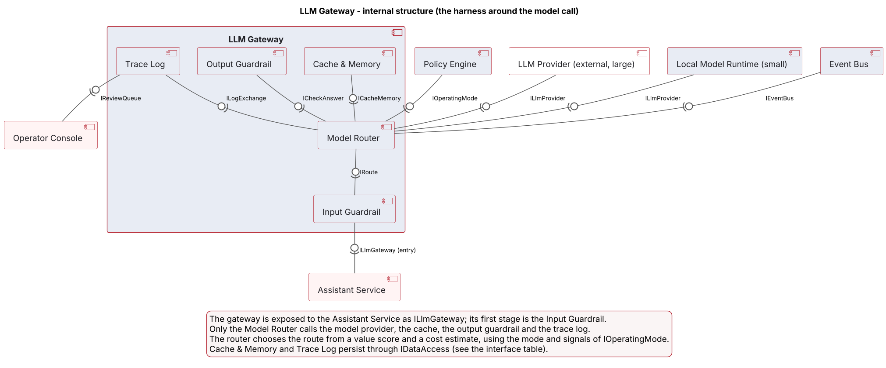

# Smart Shopping - Architecture

## Objectives and drivers

Opening a product page must stay quick and predictable while imports, forecasts and AI calls run elsewhere. The two AI components (forecast model and assistant) must be replaceable and evaluated, and the application must react to a simulated carbon signal without sacrificing forecast freshness. These drivers decide the structure:

| Driver | Source | Structural consequence |
| --- | --- | --- |
| Fast, predictable read path | NFR-01, NFR-04 | Stored forecasts, read-only request path ([ADR-006](adr/ADR-006.md)); batch work in separate workloads ([ADR-001](adr/ADR-001.md)). |
| Trustworthy, repeatable data | NFR-05 | Relational store with provenance keys and idempotent writes ([ADR-002](adr/ADR-002.md)). |
| Replaceable and evaluated AI | NFR-07, NFR-11, NFR-12, NFR-14 | Forecast adapter and evaluation gate ([ADR-003](adr/ADR-003.md), [ADR-008](adr/ADR-008.md)); LLM gateway with router and guardrails ([ADR-007](adr/ADR-007.md)). |
| Behaviour and placement that follow energy conditions | NFR-03, NFR-10, NFR-13, NFR-16, NFR-20 | Sensing and policy components, operating mode in the store ([ADR-004](adr/ADR-004.md)); a Placement Controller moves flexible workloads ([ADR-013](adr/ADR-013.md)). |
| Loose coupling of reactions | NFR-13, NFR-19 | Publish-subscribe event bus on top of the database state ([ADR-012](adr/ADR-012.md)). |
| Right serving pattern per model | NFR-01, NFR-02, NFR-18 | Batch prediction for forecasts, model-as-a-service for the assistant, local small and external large model ([ADR-011](adr/ADR-011.md), [ADR-015](adr/ADR-015.md)). |
| Evidence for quality and energy | NFR-08, NFR-10, NFR-17 | Prometheus, Grafana, tracing, measured or estimated energy ([ADR-014](adr/ADR-014.md), [Observability](observability.md)). |
| Different workload lifecycles | NFR-09 | Kubernetes Deployments, CronJobs and Jobs ([ADR-005](adr/ADR-005.md)). |
| Repeatable delivery | NFR-15 | CI/CD with GitOps ([ADR-009](adr/ADR-009.md)). |
| Clear, checkable structure | course architecture principles | Components defined by interfaces and an allowed-to-use specification ([ADR-010](adr/ADR-010.md)). |

## Views of the architecture

The lectures name two documentation styles: the **C4 model** (context, containers, components, code; a quick structural sketch) and the **4+1 view model** (logical, development, process and physical views, validated against scenarios for several stakeholders). We use UML for the precise views and C4 for the quick ones, and the table shows how they fit together.

| 4+1 view | Question | Our artifact |
| --- | --- | --- |
| Scenarios (+1) | Which use cases validate the design? | [Use-case model](diagrams/use-case.puml), [significant use cases](significant-use-cases.md) |
| Logical | What are the parts and their interfaces? | [Component model](diagrams/09-component.puml), [communication diagram](diagrams/08-communication.puml), [LLM Gateway structure](diagrams/component-llm-gateway.puml), [data model](diagrams/class-model.puml) |
| Process | How do the parts interact at run time? | Seven sequence diagrams and three detailed carbon sequences (section "Runtime behaviour" below), [mode decision](diagrams/carbon-policy-activity.puml) |
| Development | How is the code organised and built? | Modular backend, allowed-to-use rules (below), [CI/CD](cicd.md) |
| Physical | Where does it run? | [Kubernetes deployment](diagrams/deployment-kubernetes.puml) |

| C4 level | Artifact |
| --- | --- |
| 1 Context | [c4-context.puml](diagrams/c4-context.puml) |
| 2 Containers | [c4-container.puml](diagrams/c4-container.puml) |
| 3 Components | [09-component.puml](diagrams/09-component.puml) |
| 4 Code | Not drawn; generated from the code once it exists. |

## How to read the component model

The [component model](diagrams/09-component.puml) is a static UML 2 view. It shows **components and the interfaces they provide and require**, not data or control flow. A ball is a provided interface, a socket is a required interface, and a connector joins a socket to a ball; there are no arrows between components. The same connector means *"the left component is allowed to use the interface of the right one"*. Sequence diagrams show how the components then communicate over time. The diagram uses role names rather than products (no React, FastAPI or PostgreSQL); technologies appear only in the deployment view and the ADRs.

Each connector joins a provided interface (ball) to a required interface (socket); there are no plain arrows. Blue-grey = technical component (type T), pink = application component (type A), white = external system. Cross-cutting interfaces are listed in the interface table (docs/architecture.md) and not drawn: IDataAccess (Data Store) is required by Catalog Query, Price Evidence, Forecast Service, Watch Monitor, Forecast Worker, Model Evaluator, Price Importer, Carbon Monitor, Policy Engine, Job Scheduler, Placement Controller and LLM Gateway; ITelemetry (Telemetry) is required by Shopping API, Watch Monitor, Job Scheduler, Price Importer, Model Evaluator, Carbon Monitor, Policy Engine, Placement Controller and LLM Gateway; IOpsView (Telemetry) by Operator Console. IEventBus carries price.changed (Price Importer publishes, Job Scheduler consumes), mode.changed (Policy Engine publishes; Job Scheduler, LLM Gateway and Placement Controller consume) and events.dead (failed events). The database stays the source of truth (pull). Watch Monitor is called by the Shopping API (IWatchlist) and started by the Time Trigger (IWatchCheck).

The [communication diagram](diagrams/08-communication.puml) complements the static model: it shows how the component instances talk to each other in ASUC-01, with numbered and nested messages (3.1 is a call made while message 3 is handled).

Objects are component instances; links carry numbered messages (1, 3.1, 4.1.1 = nested call). Square brackets mark a guard. No forecast is calculated during the request (ADR-006).

Components follow the course's two blood types: **type A** components implement application (domain) functions, **type T** components implement technical functions. A component never mixes both.

The assistant harness is a composite component whose internal structure is shown separately.

## Component catalogue

| Component | Type | Responsibility (one concern) | Provides | Requires |
| --- | --- | --- | --- | --- |
| Shopper Client | Presentation | Search, history chart, evidence, advice, assistant dialogue, in-browser shortlist, price watch form and alert list. | - | IShoppingAPI, IAssistantAPI |
| Operator Console | Presentation | Policy editing, mode override, review queue, dashboards. | - | IPolicyAdmin, IReviewQueue, IOpsView |
| Shopping API | T | Public REST facade: validation, composition of the insights response, comparison, alternatives for constraints, watchlist calls. | IShoppingAPI | ICatalog, IPriceEvidence, IAdvice, IWatchlist, ITelemetry |
| Catalog Query | A | Search, filter, sort and current offers. | ICatalog | IDataAccess |
| Price Evidence | A | Daily lowest valid offer, 30-day reference, delta, data sufficiency. | IPriceEvidence | IDataAccess |
| Advice Engine | A | Buy Now, Wait or Insufficient Evidence rules and reasons. | IAdvice | IForecastRead |
| Watch Monitor | A | Device-scoped price watch: validate and store watches, scheduled check against fresh offers, one alert per episode with a deduplication key, alert list. | IWatchlist, IWatchCheck | ICatalog, IDataAccess, ITelemetry |
| Forecast Service | A | Latest stored forecast, its age and freshness status. | IForecastRead | IDataAccess |
| Assistant Service | A | Builds the evidence payload and calls the gateway; assistant entry point. | IAssistantAPI | IPriceEvidence, IAdvice, ILlmGateway |
| LLM Gateway | T | Harness around the model call: input guardrail, router with a value and cost gate, cache and memory, output guardrail, trace log. | ILlmGateway, IReviewQueue | ILlmProvider (local and external), IOperatingMode, IEventBus, IDataAccess, ITelemetry |
| Forecast Worker | A | Computes one stored seven-day forecast for a laptop. | IForecastJob | IForecastModel, IDataAccess |
| Forecast Model Adapter | T | Uniform interface to the baseline and the candidate model. | IForecastModel | IModelRuntime |
| Model Evaluator | A | Backtests baseline and candidate and stores the adoption decision. | IModelEvaluation | IForecastModel, IOperatingMode, IDataAccess, ITelemetry |
| Price Importer | A | Keep the raw batch, validate, normalize and idempotently upsert observations; publish `price.changed`; write the import report. | IIngest | IPriceSource, IOperatingMode, IEventBus, IDataAccess, ITelemetry |
| Carbon Monitor | T | Fetch, validate and store energy samples (carbon intensity, price, renewable flag). | IEnergySignal | IEnergyFeed, IDataAccess, ITelemetry |
| Policy Engine | T | Versioned policy, mode and placement-target decision with hysteresis, override, audit; publishes `mode.changed`. | IOperatingMode, IPolicyAdmin, IPolicyEvaluation | IEnergySignal, IEventBus, IDataAccess, ITelemetry |
| Job Scheduler | T | Create jobs on `price.changed`, claim due jobs with a lease, decide run or defer, record energy and emissions. | IScheduling | IForecastJob, IModelEvaluation, IOperatingMode, IEventBus, IDataAccess, ITelemetry |
| Placement Controller | T | Move flexible workloads between node pools with taints, under safety rules; record decisions. | - | IOperatingMode, IEventBus, IClusterControl, IDataAccess, ITelemetry |
| Event Bus | T | Deliver `price.changed` and `mode.changed` notifications (at-least-once). | IEventBus | - |
| Local Model Runtime | T | Host the small open-weight model used by the router. | ILlmProvider | - |
| Telemetry | T | Metrics collection and dashboards. | ITelemetry, IOpsView | - |
| Data Store | T | Durable relational storage. | IDataAccess | - |
| Time Trigger, Price Data Provider, Energy Signal Provider, LLM Provider, Pretrained Forecast Model, Kubernetes API | External | Scheduling and external services. | IScheduling callers, IPriceSource, IEnergyFeed, ILlmProvider, IModelRuntime, IClusterControl | IIngest, IScheduling, IEnergySignal, IPolicyEvaluation (Time Trigger) |

## Interface catalogue

| Interface | Provided by | Required by | Main operations | Style |
| --- | --- | --- | --- | --- |
| IShoppingAPI | Shopping API | Shopper Client | `findProducts`, `getInsights(productId, constraints?)`, `compare`, `saveWatch`, `getAlerts` | Synchronous request-response |
| IAssistantAPI | Assistant Service | Shopper Client | `ask(question, productId, sessionId)` | Synchronous request-response |
| ICatalog | Catalog Query | Shopping API, Watch Monitor | `findProducts`, `getProduct`, `getCurrentOffers`, `findAlternatives(constraints, excluding)` | In-process call |
| IPriceEvidence | Price Evidence | Shopping API, Assistant Service | `getEvidence(productId)` | In-process call |
| IAdvice | Advice Engine | Shopping API, Assistant Service | `advise(productId, evidence, constraints?)` returns action, reasons, caveats, within budget, needs alternatives | In-process call |
| IWatchlist | Watch Monitor | Shopping API | `saveWatch`, `listWatches`, `setEnabled`, `deleteWatch`, `listAlerts`, `markRead` (all scoped to a device id) | In-process call |
| IWatchCheck | Watch Monitor | Time Trigger | `checkWatches()` | Scheduled, idempotent |
| IForecastRead | Forecast Service | Advice Engine | `getLatest(productId)` with status FRESH, STALE or MISSING | In-process call |
| ILlmGateway | LLM Gateway | Assistant Service | `complete(intent, question, evidencePayload, sessionId)` | In-process call |
| IReviewQueue | LLM Gateway | Operator Console | `listFlagged`, `recordDecision` | Request-response |
| ILlmProvider | LLM Provider, Local Model Runtime | LLM Gateway (Model Router) | `complete(model, prompt, sampling)` | Request-response (external or in-cluster) |
| IForecastJob | Forecast Worker | Job Scheduler | `run(job)` | Job start |
| IForecastModel | Forecast Model Adapter | Forecast Worker, Model Evaluator | `predict(series, horizon)` | In-process call |
| IModelRuntime | Pretrained Forecast Model | Forecast Model Adapter | model inference | Library or service call |
| IModelEvaluation | Model Evaluator | Job Scheduler | `evaluate(models, window)` | Job start |
| IIngest | Price Importer | Time Trigger | `runImport(sourceId)` | Job start |
| IEventBus | Event Bus | Policy Engine, Price Importer (publish); Job Scheduler, LLM Gateway, Placement Controller (subscribe) | `publish(topic, event)`, `subscribe(topic, group)`; topics `price.changed`, `mode.changed`, `events.dead` (see [event bus](event-bus.md)) | Publish-subscribe, at-least-once |
| IClusterControl | Kubernetes API | Placement Controller | `listNodes`, `patchNodeTaints` | External request-response, least-privilege account |
| IPriceSource | Price Data Provider | Price Importer | `fetch(batch)` | External pull |
| IEnergyFeed | Energy Signal Provider | Carbon Monitor | `getSignals(region)` returns intensity, price, renewable flag | External pull (simulator or live) |
| IEnergySignal | Carbon Monitor | Policy Engine, Time Trigger | `refresh()`, `latest(n)` | In-process call, job start |
| IOperatingMode | Policy Engine | Job Scheduler, LLM Gateway, Price Importer, Model Evaluator, Placement Controller | `current()` returns mode, reason, since, parameters, placement target and the latest signal snapshot (carbon intensity, price, renewable flag, each with its age) | Pull, cached up to 60 s (source of truth; events notify earlier) |
| IPolicyAdmin | Policy Engine | Operator Console | `getPolicy`, `putPolicy`, `setOverride` | Authenticated request-response |
| IPolicyEvaluation | Policy Engine | Time Trigger | `evaluate()` | Job start |
| IScheduling | Job Scheduler | Time Trigger | `tick()` | Job start |
| ITelemetry | Telemetry | Shopping API, Watch Monitor, Job Scheduler, Price Importer, Model Evaluator, Carbon Monitor, Policy Engine, Placement Controller, LLM Gateway | record metrics and events | Fire and forget |
| IOpsView | Telemetry | Operator Console | dashboards | Read-only view |
| IDataAccess | Data Store | Catalog Query, Price Evidence, Forecast Service, Watch Monitor, Forecast Worker, Model Evaluator, Price Importer, Carbon Monitor, Policy Engine, Job Scheduler, Placement Controller, LLM Gateway | persistence of the entities in [Data model and API](data-model-api.md) | Transactional |

The last two rows are cross-cutting. Their sockets are not drawn in the picture, to keep it readable, but they are part of the model and of the allowed-to-use specification below.

## Allowed-to-use specification

Architecture is the set of components plus the usage relationships that are allowed. A component may use only the interfaces listed in its *Requires* column above; any other dependency is forbidden and should be caught in review and, later, by a dependency check in the pipeline. Three rules follow from the course principles:

- **Acyclic usage.** The usage graph has no cycles. Technical components do not use application components, with two deliberate exceptions: the Shopping API facade composes the application components for the client, and the Job Scheduler only starts jobs through `IForecastJob` and `IModelEvaluation`.
- **One concern per component, once.** For example, the signal provider is called only by the Carbon Monitor, the model providers only by the Model Router and the cluster API only by the Placement Controller. All other components obtain the energy state through `IOperatingMode`, with the event bus as a notification only.
- **Models are separated from business logic.** The forecast model sits behind `IForecastModel` and the LLM behind the gateway; the advice rules never depend on either.

## Runtime behaviour

| Use case | Sequence | What it shows |
| --- | --- | --- |
| UC2 | [03-analysis](diagrams/03-analysis.puml) (ASUC-01, evidence) | Read path with evidence states and the stored forecast with its age. |
| UC2 | [04-recommendation](diagrams/04-recommendation.puml) (ASUC-01, advice) | Rules, budget and brand constraints, alternatives. |
| UC2 | [08-communication](diagrams/08-communication.puml) | The same interaction as a communication diagram with numbered, nested messages. |
| UC2 extension | [07-ai-explanation](diagrams/07-ai-explanation.puml) (ASUC-02) | Guardrails, routing, cache, retry, fallback, tracing. |
| UC2 extension | [05-monitoring](diagrams/05-monitoring.puml) (SQ-02) | Device-scoped watch, scheduled check, one alert per episode, in-app alerts (supplementary). |
| UC1 | [02-compare](diagrams/02-compare.puml) (SQ-01) | Search, comparison and the empty result (supplementary). |
| UC3 | [01-import](diagrams/01-import.puml) (ASUC-03) | Raw layer, validation, idempotent upsert, event, forecast job creation. |
| UC4 | [06-carbon](diagrams/06-carbon.puml) (ASUC-04, overview) | Sense, decide, notify, act and place in one picture. |
| UC4 | [ASUC-04a](diagrams/detail/sequence-carbon-decide.puml), [ASUC-04b](diagrams/detail/sequence-carbon-act.puml), [ASUC-04c](diagrams/detail/sequence-carbon-place.puml) | Detail: configure, sense, decide; act and feedback; relocate flexible workloads. |

## Deployment and operation

The deployment view in [Kubernetes design](kubernetes-design.md) maps the logical components to workloads on two node pools. One modular backend hosts the Shopping API, Assistant Service, LLM Gateway and the policy administration entry point; the Policy Engine is one module used by the backend (administration) and by the carbon-controller job (evaluation). Delivery is described in [CI/CD](cicd.md). All diagrams are proposals, not infrastructure evidence.

## Limitations

- The design is implemented in part (see [implementation status](implementation.md): shopper path, control loop, gateway, PostgreSQL); the Kubernetes deployment of the application, observability stack, drift shapes and the golden set are not. Targets are test criteria, not results.
- A full database outage is not covered without a separately provisioned read cache.
- The energy signals and the node pools are simulated and the energy estimates need a documented method (or a working measurement); lower emissions and costs are outcomes to measure.
- The event bus is a single broker in the demonstration; it is not part of the shopper path and carries no availability claim.
- The synthetic 30-day dataset limits what the forecast evaluation can show.
- Deferring work can make forecasts older; the deadline limits this but cannot guarantee success when dependencies fail.
