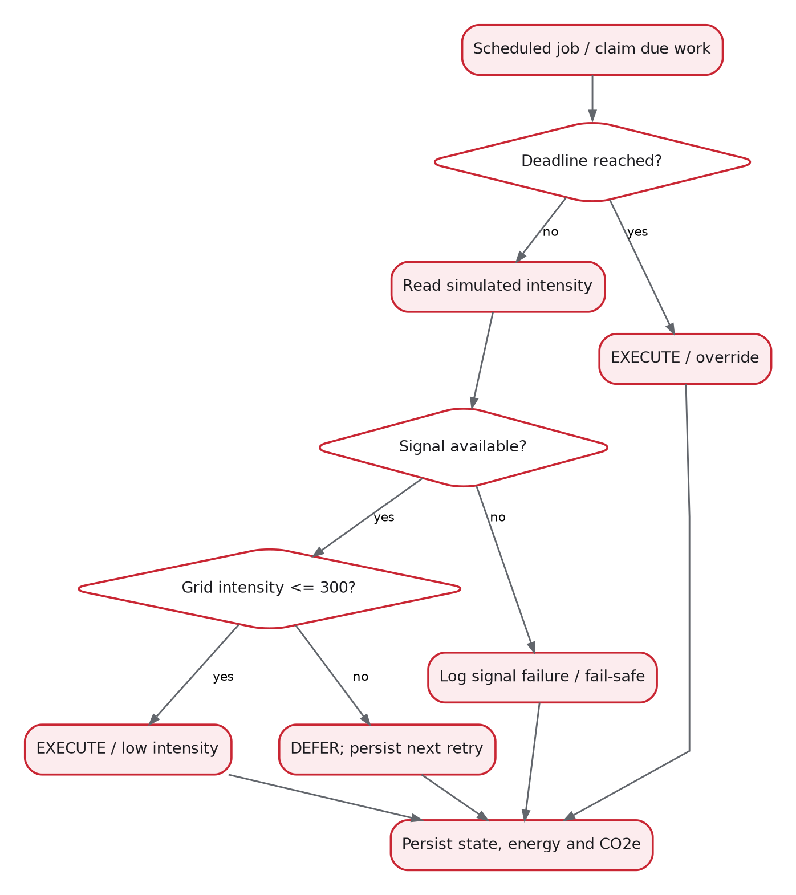

# Carbon- and price-adaptive operation

The first revision only read a carbon signal and deferred forecast jobs. The reviewers asked how the application becomes *aware* of carbon and how it changes its configuration and behaviour. The lectures added two points: electricity **price** matters as much as carbon (hyperscalers choose where to compute because it is cheaper, and clean energy is a side effect), and the strongest form of adaptation is that **the application moves itself** to where energy is cheaper or cleaner, in addition to switching its own behaviour. This document defines both layers. All signals are **simulated** (Electricity Maps is an optional live source); thresholds are configurable demonstration values, not industry standards.

## The loop: sense, decide, act, feedback

| Step | Component | What happens |
| --- | --- | --- |
| Sense | Energy Monitor | Every 5 minutes it fetches carbon intensity (gCO2e/kWh), electricity price (EUR/kWh) and a renewable-available flag, validates each value (range, timestamp) and stores the sample; a failed fetch is stored as MISSING. |
| Decide | Policy Engine | Every 5 minutes it classifies intensity and price separately against the active policy with hysteresis, takes the more restrictive class, lets available renewable energy force GREEN, applies any operator override and persists the *operating mode* with its reason, parameters and placement target. A mode change is published as an event. |
| Act, layer 1: behaviour | Job Scheduler, Model Router, Price Importer, Model Evaluator, workers, caches | Each consumer reads `IOperatingMode.current()` (cached up to 60 s; the event only makes the change visible earlier) and changes how it works. Nobody except the Energy Monitor talks to the signal provider. |
| Act, layer 2: placement | Placement Controller | Moves the *flexible* workloads between the standard and the eco node pool with taints. |
| Feedback | Telemetry, job execution log | Mode changes, deferrals, placements, kWh and gCO2e are recorded; the operator compares them with an immediate-run baseline and may change the policy. |

Sequences: [ASUC-04a](diagrams/previews/sequence-carbon-decide.png) (configure, sense, decide), [ASUC-04b](diagrams/previews/sequence-carbon-act.png) (act, feedback) and [ASUC-04c](diagrams/previews/sequence-carbon-place.png) (relocate flexible workloads). Decision logic: [activity diagram](diagrams/previews/carbon-policy-activity.png).

## Signals and operating modes

| Mode | Carbon intensity (default) | Electricity price (default) | Meaning |
| --- | --- | --- | --- |
| GREEN | up to 300 gCO2e/kWh | up to 0.20 EUR/kWh | Normal operation. |
| AMBER | above 300 up to 450 | above 0.20 up to 0.30 | Reduce optional work. |
| RED | above 450 | above 0.30 | Minimum energy use that still keeps deadlines and the shopper path. |

The mode is the **more restrictive** of the two classes. If renewable energy is available the mode is GREEN (renewable energy is always preferred, and deferring work would waste it), and the placement target is the eco pool. Price and carbon often move together but not always: cheap energy can be dirty and clean energy can be expensive, which is why both are kept as separate inputs and the reason of every decision names the signal that caused it.

**Hysteresis.** A signal's class rises only after two consecutive samples above a threshold and falls only when the value is below the threshold by the margin (default 10 %: carbon AMBER to GREEN at 270 and RED to AMBER at 405; price at 0.18 and 0.27). This avoids flapping (NFR-16).

**Missing signal.** If there is no valid sample for longer than the stale limit (default 30 minutes), the Policy Engine behaves as GREEN with the reason `signal_stale` and raises a metric. If only one signal is missing, the other still decides. Service quality has priority over a guess about carbon.

**Operator override.** The operator can force a mode for at most 24 hours, for example for a demonstration or an incident. The override is audited and expires on its own.

**Signal sources.** The Energy Signal Provider has two implementations behind one interface (`IEnergyFeed`): a **simulator** that produces a cheap and an expensive phase with a slow wave and random jumps and toggles renewable availability on a configurable schedule, and an optional **Electricity Maps adapter** for real data. The simulator exposes the same values as Prometheus metrics, so dashboards show what the controller saw. Region and provider choice matter for real deployments (European region preferred).

## What changes in each mode (layer 1: behaviour)

| Behaviour | GREEN | AMBER | RED |
| --- | --- | --- | --- |
| Forecast jobs | Run all due jobs | Run a job only if at most half of its deadline window remains; defer the others | Defer until the deadline |
| Deadline reached | Run | Run | Run (the deadline wins in every mode) |
| Worker concurrency | 3 | 1 | 1 |
| Assistant route (router, value and cost, [AI architecture](ai-architecture.md)) | Template, cache, small local model for V of at least 1; the large external model only for V of at least 3 after a failed check | Template, cache, small model for V of at least 2; no large model | Template or cache only; answer labelled *simplified* |
| Cache lifetime (insights and assistant) | 5 min | 30 min | 60 min |
| Optional batches (model evaluation, import backfills) | Run | Defer | Defer |
| Mandatory daily import | Run | Run | Run |
| Shopper interface | No notice | No notice | Short notice that AI explanations are simplified to save energy |

Two protections prevent starvation and silent degradation. Optional batches have a maximum deferral of 7 days, after which they run in any mode. The mandatory daily import is never shifted, because users see current observations and the earlier review showed that reducing collection is not a substitute for lower emissions.

## Placement (layer 2: the application moves itself)

The cluster has two node pools: **standard** (fast, default) and **eco** (a simulated node group with lower carbon or price, and lower speed or power). In a local cluster they are two labelled nodes; in a real deployment they would be node groups in different zones or regions. The target pool comes from the mode:

| Condition | Placement target for flexible workloads |
| --- | --- |
| GREEN without renewable energy | standard |
| AMBER or RED | eco |
| Renewable energy available (mode GREEN) | eco |

**Mechanism.** The Placement Controller taints the non-target pool with `energy-role=blocked:NoExecute` and removes the taint from the target pool. Pods without a matching toleration (forecast and evaluation Jobs, the local model runtime) are evicted and Kubernetes reschedules them on the target pool; nobody chooses a node by hand. The request path (frontend, backend), the database, the event broker, monitoring and the controller itself carry a toleration and never move. This is the same pattern as the course demonstration (labelled nodes, taints, tolerations, a polling scheduler installed with Helm), adapted to our modes.

**Safety.** The controller changes taints only when the decision changes (otherwise every loop would evict pods), keeps a dwell time of 15 minutes between changes, requires a ready node in both pools, never leaves zero schedulable nodes and records every decision including skipped ones (NFR-20). An evicted Job is idempotent and leased, so it is retried before its deadline; the deadline still wins in every mode.

**Trade-off.** The eco pool may be slower, so a relocated job takes longer. This is a design question the experiment answers with numbers (a slower node used rarely versus a stronger node used when speed matters), not an assumption.

## What changes in the project when a signal changes

This table follows one change of a signal through the whole system, so that behaviour and configuration changes are traceable. All values are demonstration defaults and are configurable.

| Change in the signal | Decision (Policy Engine) | What changes automatically | What stays | Visible in |
| --- | --- | --- | --- | --- |
| Carbon intensity rises above 300 (two samples) | GREEN to AMBER | Jobs wait until half of the deadline window is left; concurrency 3 to 1; router raises the required value (SMALL needs V of at least 2, no LARGE); cache lifetime 5 to 30 min; optional batches deferred; placement target eco | Deadlines, mandatory import, stored prices, forecast display | `operating_mode`, `mode_changes_total`, `placement_decisions_total` |
| Carbon intensity rises above 450 | AMBER to RED | Jobs wait until the deadline; router answers only from templates or cache with a *simplified* label and a shopper notice; cache lifetime 60 min | Deadlines, mandatory import, shopper path | `router_decisions_total` (reason, mode), assistant route shares |
| Electricity price rises above 0.20 or 0.30 EUR/kWh | GREEN to AMBER or RED, even if carbon is low (the more restrictive signal decides) | The same as for carbon at that level; the cost estimate of each call uses the new price | As above | `electricity_price_eur_per_kwh`, `assistant_estimated_cost_eur_total` |
| Renewable energy becomes available | Mode GREEN, placement target eco | Deferred jobs are released; flexible workloads move to the eco pool; router allows SMALL and, with enough value, LARGE | Safety rules of placement (dwell time, ready nodes) | `renewable_available`, `placement_decisions_total` |
| A signal falls below its threshold minus 10 % | Class falls (hysteresis) | The previous changes are reversed in the same way | Nothing is reversed on a single noisy sample | `mode_changes_total` |
| A signal is missing for more than 30 minutes | GREEN with reason `signal_stale`, or the other signal decides | Normal operation; the router logs unknown cost | The shopper path | `signal_status` |
| The operator edits the policy or overrides the mode | New policy version or forced mode with expiry | Takes effect without redeployment within the pull interval (NFR-13) | History and audit entries | policy version, audit log |

## Runtime reconfiguration

Policy defaults live in Git (ConfigMap) and seed the first policy version. At runtime the operator edits the policy through the Operator Console; the Policy Engine validates it (ascending thresholds for both signals, margin 0-30 %, deadline 1-72 h, override at most 24 h, placement dwell time), stores a new immutable version with the author and the change, and uses it at the next evaluation. The current mode, its reason, its parameters, its placement target and the policy version are stored in the database, so every workload sees the same state and a change needs no redeployment (NFR-13). The effective delay is at most one evaluation interval plus the 60 s cache; the `mode.changed` event usually makes it shorter.

## Energy and carbon estimate

`energy_kWh = average_power_W * duration_s / 3,600,000`  
`estimated_gCO2e = energy_kWh * grid_intensity_gCO2e_per_kWh`  
`estimated_cost_EUR = energy_kWh * price_EUR_per_kWh`

For jobs we need a documented power estimate (a configured average power per worker and pool class) or a measurement if available (Kepler for pods, CodeCarbon for Python jobs; see [Observability](observability.md)). For assistant calls the energy is an **estimated value** derived from tokens and a configured factor per model class; the factor is an assumption to be calibrated and is reported as such. The estimate covers server-side compute, not laptop manufacturing or shipping. Energy savings and lower grid intensity are separate effects: shifting a fixed job can reduce emissions or cost even if energy stays the same, while retries, evictions and extra runtime can cancel the benefit.

## Evaluation plan (NFR-10)

1. Replay the same simulated 7-day trace of intensity, price and renewable flag three times with the same forecast jobs and assistant questions.
2. Run A: *immediate* (policy fixed to GREEN, no placement). Run B: *adaptive behaviour* (default policy, no placement). Run C: *adaptive behaviour and placement*.
3. Record per run: total kWh (and the method: estimated or measured), estimated gCO2e and cost, deferrals, deadline overrides, deadline misses, maximum and 95th-percentile forecast age, failures, retries and evictions, assistant route shares, tokens, API p95 latency.
4. Run D (routing): replay the same assistant questions through *always SMALL*, *always LARGE* and *the router*, and record tokens, estimated Wh, gCO2e, cost and the share of grounded answers, so the effect of the value and cost gate is shown with numbers.
5. Run the same forecast job on both pools and report execution time, energy and estimated gCO2e, so the speed versus energy trade-off is shown with numbers.
6. Report differences with their limits (simulated signals, synthetic data, estimation method, a small cluster). Do not claim savings that were not measured.

## Risks

| Risk | Mitigation |
| --- | --- |
| Forecasts become older during long RED periods | Persisted deadline, forced execution, NFR-02 monitoring. |
| Mode flapping | Hysteresis, two-sample rule, NFR-16 test with a noisy trace. |
| Wrong or missing signal | Validation, MISSING samples, stale-signal fail-safe, one signal can carry on without the other. |
| Operator error | Validated policy, audit trail, expiring override, version history. |
| Evictions waste work or starve the cluster | Dwell time, safety checks, idempotent leased jobs, tolerations for the request path, NFR-20. |
| Adaptation costs more than it saves | Compare with the immediate-run baseline; keep overhead (evictions, retries) visible. |
| The controller has cluster permissions | Dedicated service account with only the permissions to read nodes and patch taints; audit of decisions. |
