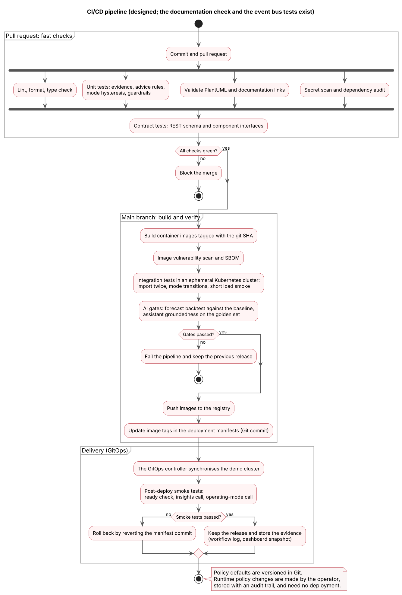

# CI/CD

The first revision named CI/CD in the verification plan but did not design it. This document describes the target pipeline, what exists today and the evidence we will collect. Delivery is a quality attribute (NFR-15) and it also protects the AI components: a model or prompt change is released only if its gates pass.

## Principles

- **Trunk-based development** with short pull requests; required checks block the merge.
- **Everything as code:** application, infrastructure manifests, carbon policy defaults, prompts and PlantUML sources live in this repository.
- **Build once, promote the same image.** Images are tagged with the git SHA; environments differ only in configuration.
- **GitOps delivery.** The pipeline commits new image tags to the deployment manifests; a GitOps controller in the cluster applies them. Rollback is a revert of that commit.
- **AI changes are gated like code.** Forecast and assistant quality are measured in the pipeline before release.

## Stages and gates

| Stage | Trigger | Checks | Gate |
| --- | --- | --- | --- |
| 1. Fast checks | Pull request | Lint, format, type check; unit tests for evidence, advice rules, mode hysteresis, guardrails and the importer; PlantUML syntax and link check; secret scan; dependency audit | All green |
| 2. Contract tests | Pull request | REST schema compatibility; component interface contracts against the [interface catalogue](architecture.md) | No breaking change without a version bump |
| 3. Build | Merge to main | Build images for frontend, backend and workers with the git SHA; vulnerability scan; software bill of materials | No critical findings |
| 4. Integration | Merge to main | Ephemeral Kubernetes cluster: migrations, import the same batch twice (no duplicates), simulated carbon trace through GREEN, AMBER and RED, deadline override, short load smoke at the target request rate | All scenarios pass |
| 5. AI gates | Merge to main | Forecast backtest: candidate MAE not worse than the baseline ([ADR-008](adr/ADR-008.md)); assistant golden set: groundedness and label agreement meet NFR-11, with a capped model budget; the small local model is used so the gate runs on a self-hosted runner | Thresholds met |
| 6. Publish | Merge to main | Push images; commit new tags to the deployment manifests | Stages 3-5 green |
| 7. Deploy | Manifest commit | The GitOps controller synchronises the demo cluster; a change to a model or prompt goes through shadow and staged rollout ([AI architecture](ai-architecture.md)) | Sync healthy |
| 8. Verify | After deploy | Smoke tests: ready check, one insights call, operating-mode call, a metrics scrape | Pass, otherwise roll back |

## Continuous integration practice

- **Flow:** work on a branch, open a pull request, merge to `main` only when the required checks pass (branch protection), merging triggers the build and the deployment. Deployment happens from `main` only.
- **Unit tests on every push** run first; the cheapest check gives the fastest feedback.
- **Self-hosted runner for AI steps.** Stages that need the local model, or data that must stay under our control, run on a self-hosted runner (a machine we operate, for example the one that hosts the local model). A runner has access to the repository, the cluster and the code, so it must clean up after every job (virtual environment, output files) and be registered with the minimum scope. Cloud-hosted runners do the rest. A job that runs only on a single machine can block every other push, so a second runner is planned.
- **Manual trigger and evaluation workflow.** A manually started workflow runs the golden-set evaluation on demand and fails if the answer is empty, too short, or contains an error marker, which catches a broken model before a release.
- **Packaging.** The placement controller is packaged as a Helm chart; a local copy of any third-party chart is kept so that an upstream change cannot break a build.

## Environments

| Environment | Purpose | Notes |
| --- | --- | --- |
| Local | Development | Containers for the database and workers; stubbed carbon feed and model provider. |
| CI | Automated tests | Ephemeral cluster created per run, removed afterwards. |
| Demo cluster | Course demonstration and evidence | Receives every green main build; policy defaults come from the ConfigMap in Git. |

## Configuration, secrets and policy

Carbon policy defaults and prompt versions are versioned in Git. The operator's runtime policy changes are stored in the database with an audit trail and are deliberately *not* a deployment (NFR-13). Secrets (database credentials, model provider key) are Kubernetes Secrets or CI secrets and never appear in the repository (NFR-06).

## Carbon-aware pipeline (optional)

Heavy scheduled pipeline work, such as the nightly extended evaluation, can ask the same Policy Engine mode before it starts and defer in AMBER or RED up to a maximum delay. This is optional and is only meaningful once the application runs. Pull-request checks are never deferred.

## What exists today

Four workflows exist and **none of them has run on GitHub**. What was run locally is listed per workflow.

| Workflow | Content | Checked locally |
| --- | --- | --- |
| [`ci-cd.yml`](../.github/workflows/ci-cd.yml) (revision 9, main pipeline) | `lint` (compile, yamllint, shellcheck) → `test` (calls `app.yml`) → `manifests` (kustomize build of three overlays, kubeconform against the 1.31 schemas, promtool, the manifest tests) → `carbon-experiment` (re-run and diff against the committed result) → `image` (build, start the container and probe it, save the image, push `ghcr.io/<owner>/<repo>:<commit sha>` and `latest` on `main`) → `deploy-kind` (two-pool kind cluster, load exactly this commit's image, `kubectl apply -k`, `scripts/smoke.sh`, diagnostics and the output as artifacts) | `actionlint`, `yamllint` and `shellcheck` find nothing; the commands of `manifests` and `carbon-experiment` were run; the image was built and started once on a locally assembled base |
| [`app.yml`](../.github/workflows/app.yml) | Reusable: the whole test suite on SQLite and on a `postgres:16` service container, then the application started with `--demo` and queried with `curl` | The same tests and start-up were run locally against PostgreSQL 16 |
| [`events.yml`](../.github/workflows/events.yml) | Event bus unit tests, the demonstration, integration tests against an `apache/kafka` service container | Unit tests pass locally; the integration tests never ran |
| [`docs-validate.yml`](../.github/workflows/docs-validate.yml) | Syntax check of every PlantUML file | Ran locally on the diagrams of revision 2 and on a broken file, where it failed as intended; not re-run since |

The deployment step is **push-based into a throw-away kind cluster inside the pipeline**; the GitOps pull model with Argo CD described above is not implemented. The same image that the smoke test exercises is the one pushed to GHCR (it is built once and saved as an artifact). Not covered: security scanning of the image, signing, a staging environment, rollback automation, and a carbon-aware deferral of heavy jobs.
