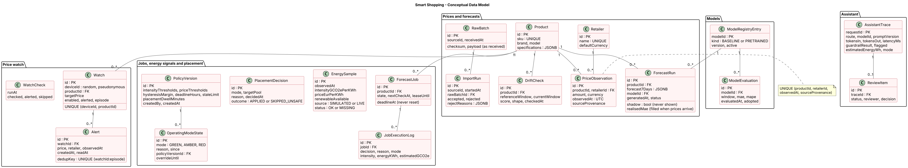

# Relational data model and API contract

> **Revision 8:** the API below is implemented (`src/shopping/api.py`) with the differences listed in [implementation status](implementation.md): text identifiers instead of integers (`{id}` is the laptop id), the extra endpoints `GET /status`, `POST /ops/imports`, `POST /ops/step`, `GET /ops/models`, `GET /ops/jobs`, `GET /ops/traces`, `GET /ops/audit` and `DELETE /ops/mode-override`, a header `X-Device-Id` for watches and alerts, and a bearer token for `/ops/*` and `/metrics`. The schema is implemented in `src/shopping/schema.py` with different table names (`observations`, `forecasts`, `model_registry`, `traces`, `review_queue`) and without `model_evaluations`, drift shapes and `sku`. The tables below remain the design reference.

## PostgreSQL schema

PostgreSQL 16 is proposed for the 10-laptop, 3-retailer reproducible demonstration. Keys below are **design-level specifications** and need migrations and integration tests. The [conceptual model](diagrams/class-model.puml) shows the relationships.



### Prices and forecasts

| Entity | Key columns | Constraints and purpose |
| --- | --- | --- |
| `products` | `id` PK, `sku` UNIQUE | Laptop brand, model, optional JSONB specs; fixed demonstration catalog. |
| `retailers` | `id` PK, `name` UNIQUE | Retailer identity and default currency. No unverified trust score. |
| `price_observations` | `id` PK, `product_id` FK, `retailer_id` FK, `observed_at`, `source_provenance` | Uniqueness `(product_id, retailer_id, observed_at, source_provenance)`; positive amount, currency and source. |
| `raw_batches` | `id` PK, `source_id`, `received_at`, `checksum` | The batch as received (raw layer); lets a parser fix be replayed and a rejected batch be inspected. |
| `import_runs` | `id` PK, `source_id`, `started_at`, `raw_batch_id` FK | Accepted and rejected counts and reject reasons per run (FR-10). |
| `forecast_runs` | `id` PK, `product_id` FK, `model_id` FK | Seven predicted day/price pairs (JSONB), `generated_at`, status and caveat; `shadow` flag (never shown) and `realised_mae` filled when prices arrive. |
| `watches` | `id` PK, `device_id`, `product_id` FK, UNIQUE (`device_id`, `product_id`) | `target_price`, `enabled`, `alerted`, `episode`; random pseudonymous device id, no personal data (FR-06). |
| `alerts` | `id` PK, `watch_id` FK (cascade), `dedup_key` UNIQUE | `price`, `retailer`, `observed_at`, `created_at`, `read_at`; the key is watch id and episode. |
| `watch_checks` | `id` PK | Time and counts (checked, alerted, skipped) of every scheduled check. |
| `drift_checks` | `id` PK, `product_id` FK | Reference and current window, score, shape (sudden, gradual, incremental, recurring) and time (FR-20). |

### Models

| Entity | Key columns | Constraints and purpose |
| --- | --- | --- |
| `model_registry` | `model_id` PK | Kind (baseline or pretrained), version and the active flag; exactly one active model. |
| `model_evaluations` | `id` PK, `model_id` FK | Backtest window, MAE, MAPE, evaluation time and the adoption decision (FR-15, NFR-12). |

### Jobs, energy signals and placement

| Entity | Key columns | Constraints and purpose |
| --- | --- | --- |
| `forecast_jobs` | `id` PK, `product_id` FK | `deadline_at` set once (never reset by a retry), `state`, `next_check_at`, `lease_until`; at most one open job per product. |
| `job_execution_logs` | `id` PK, `job_id` FK | One row per decision: run or defer, reason, mode, intensity, duration, estimated kWh and gCO2e. |
| `energy_samples` | `id` PK, `observed_at` UNIQUE | Carbon intensity, price, renewable flag, source (simulated or live) and status (OK or MISSING). |
| `policy_versions` | `id` PK | Immutable policy (intensity and price thresholds, hysteresis margin, deadline hours, stale limit, placement dwell time) with author and time. |
| `operating_mode_state` | `id` PK, `policy_version_id` FK | Current mode, reason (which signal), since, parameters, placement target and optional override expiry. |
| `placement_decisions` | `id` PK | Mode, target pool, reason, time and outcome (APPLIED or SKIPPED with the failed check) (NFR-20). |

### Assistant

| Entity | Key columns | Constraints and purpose |
| --- | --- | --- |
| `assistant_traces` | `request_id` PK | Route and reasons, model id, prompt version, tokens, latency, guardrail result, flagged, estimated energy and mode (NFR-14). |
| `review_items` | `id` PK, `trace_id` FK | Status, reviewer and decision for flagged exchanges (FR-17). |

Session memory and the answer cache hold short-lived data with a time-to-live; they may live in the same database in the MVP.

### Integrity and concurrency

- Imports are idempotent upserts on the observation identity; repeating a batch inserts nothing new.
- Events (`price.changed`, `mode.changed`) are notifications with at-least-once delivery. Consumers are idempotent (at most one open job per laptop) and the database stays the source of truth, so a lost or duplicated event cannot corrupt state.
- Admin reads of the policy bypass the cache (read-your-writes for the operator); the shopper path reads through a cache that is keyed by the evidence hash and the forecast `generated_at`.
- A job is claimed with a lease (for example `SELECT ... FOR UPDATE SKIP LOCKED`), so two scheduler runs cannot take the same job. `concurrencyPolicy: Forbid` reduces overlap but is not exactly-once.
- Job ownership, deadlines, the operating mode and the policy are durable rows, never process memory.
- Recommended indexes: `price_observations(product_id, observed_at DESC)`, `forecast_runs(product_id, generated_at DESC)`, `forecast_jobs(state, next_check_at)`, `energy_samples(observed_at DESC)`.
- Laptop variants need a stable SKU, otherwise a comparison could mix different CPU or RAM configurations. All timestamps are UTC; the UI may convert them.

## API

The proposed HTTP API uses JSON, schema validation and an OpenAPI 3.1-compatible contract to be finalized in implementation.

### Shopper endpoints

| Method | Path | Contract |
| --- | --- | --- |
| GET | `/products?q=...&sort=...&min_price=...&max_price=...` | Matching laptops, sorted and filtered, with lowest known offer and retailer count (FR-01). |
| GET | `/products/{id}/insights` | `present`, `past`, `future`, `recommendation` with source, timestamp and freshness (FR-02, FR-03, FR-04, FR-07). |
| GET | `/products/compare?ids=1,2,3` | Up to three laptops side by side (FR-05). |
| POST | `/assistant/ask` | Body: `productId`, `question`, `sessionId`. Returns the explanation, route label and disclosure (FR-08). |
| GET | `/products/{id}/insights?budget=...&brands=...` | The same response with optional constraints: `within_budget`, `alternatives` (up to three) and the adjusted action (FR-22). |
| PUT, DELETE | `/watches/{productId}` | Create or change a watch (body: `targetPrice`, optional `enabled`) or delete it (FR-06). |
| GET | `/watches` | The watches of this device. |
| GET, POST | `/alerts`, `/alerts/read` | The alerts of this device (optionally only unread) and marking them read (FR-06). |

The shortlist (FR-06) is kept in the browser and has no endpoint. The price watch is stored by the server per device (below). Every watch endpoint takes the random device id in the header `X-Device-Id` and never returns data of another device.

### Operator endpoints (authenticated, private)

| Method | Path | Contract |
| --- | --- | --- |
| GET | `/ops/mode` | Current operating mode, reason, since, parameters. |
| GET, PUT | `/ops/policy` | Read or replace the policy; a replacement creates a new version (FR-12). |
| PUT | `/ops/mode-override` | Force a mode for at most 24 hours. |
| GET | `/ops/imports` | Import reports (FR-10). |
| GET, POST | `/ops/review-queue`, `/ops/review-queue/{id}/decision` | Flagged assistant exchanges and decisions (FR-17). |
| PUT | `/ops/model/active` | Pin or roll back the active forecast model. |
| GET | `/ops/placement` | Current placement target and the latest placement decisions. |
| GET | `/ops/drift` | Latest drift checks and live forecast error per model. |

### Operational endpoints

| Method | Path | Contract |
| --- | --- | --- |
| GET | `/health/live` | Process liveness; no heavy query. |
| GET | `/health/ready` | Readiness; fails if required dependencies such as the database are unreachable. |
| GET | `/metrics` | Prometheus metrics; **internal access only**. |

The first review used a single `GET /health`; we split it into `live` and `ready` so process liveness is not confused with dependency readiness. Both endpoints are implemented; `/health/ready` runs one trivial query and returns 503 if it fails.

### Example insights response (illustrative, not real prices)

```json
{
  "product_id": 1,
  "present": {"best_offer": {"retailer": "Sample Store", "price": 899.0, "currency": "EUR", "observed_at": "2026-11-01T09:00:00Z"}},
  "past": {"reference_30d": 950.0, "reference_method": "median_of_daily_lowest_valid_offer", "observation_days": 28, "discount_delta_pct": -5.37, "history": []},
  "future": {"horizon_days": 7, "model_id": "baseline-last-value", "generated_at": "2026-11-01T02:00:00Z", "status": "FRESH", "prices": [], "caveat": "Model estimates are uncertain"},
  "recommendation": {"action": "BUY_NOW", "reasons": ["Example response only"], "caveats": []}
}
```

If the forecast worker fails, `future.status` is `STALE` or `MISSING` and the recommendation uses the rules that need no forecast, with a caveat. Prices remain visible while the database responds. Without a separate verified read cache, a full database outage cannot satisfy a stronger availability claim.
