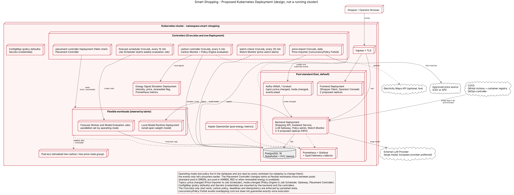

# Kubernetes, monitoring and deployment (planned)

Our proposed Kubernetes setup separates services that must stay available from jobs that run at certain times, and it has two node pools so that flexible workloads can move. The table is the intended configuration, not proof of a working cluster. The energy policy itself is described in [Carbon- and price-adaptive operation](carbon-adaptation.md). A local cluster (for example minikube with several nodes and a network plugin that gives the nodes a shared network) is enough to demonstrate it; a real deployment would use node groups in different zones.

## Deployment mapping

| Logical component | Kubernetes resource | Reason |
| --- | --- | --- |
| Shopper Client, Operator Console | `Deployment` (2 replica proposal) and ClusterIP `Service` | Stateless frontend, scaled separately from the API. |
| Shopping API, Assistant Service, LLM Gateway, policy administration | One modular backend `Deployment` (2-3 replicas proposal) and ClusterIP `Service` | Stateless request path ([ADR-001](adr/ADR-001.md)); the gateway is a module, not a separate service. |
| Ingress | Ingress controller with TLS | External access; operator paths additionally authenticated. |
| Carbon Monitor and Policy Engine evaluation | `CronJob` `carbon-controller`, every 5 minutes | Sense and decide; state is in the database, so the job itself is stateless. Publishes `mode.changed`. |
| Job Scheduler | `CronJob` `forecast-scheduler`, every 15 minutes | Claims due jobs, applies the mode, creates worker Jobs; also starts the weekly evaluation Job. It consumes `price.changed` to create jobs. |
| Forecast Worker, Model Evaluator | Short-lived `Job`s; parallelism taken from the operating mode | Concurrency 3, 1, 1 for GREEN, AMBER, RED. |
| Price Importer | `CronJob` (daily), `concurrencyPolicy: Forbid` | Mandatory daily batch; optional backfills only in GREEN. Publishes `price.changed`. |
| Watch Monitor | The watchlist calls run in the backend Deployment; the check is a `CronJob` `watch-check`, every 30 minutes, `concurrencyPolicy: Forbid` | Creates in-app alerts once per episode; idempotent through the stored alert state and the deduplication key. |
| Placement Controller | `Deployment` (one replica) installed by a Helm chart, dedicated service account (read nodes, patch taints) | Long-running reconcile loop and event consumer; tolerates every energy taint. |
| Event Bus | `StatefulSet` (Kafka in KRaft mode, one broker for the demonstration) and a Service named `kafka` | Topics `price.changed` (3 partitions), `mode.changed` (1) and `events.dead` (1), created by a Job; manifests in `deploy/kafka` ([event bus](event-bus.md)). The broker tolerates the energy taint and runs on the standard pool. |
| Local Model Runtime | `Deployment` with resource requests and limits, a Service and a volume for the model files | Flexible workload: carries no toleration and is relocated by taints. |
| Energy Signal Provider (simulator) | `Deployment` and Service `energy-simulator`, exposing `/status` and `/metrics` | Intensity, price and renewable flag; replaced by an Electricity Maps adapter when a live source is used. |
| Kepler | `DaemonSet` | Pod-level energy metrics for Prometheus. |
| Data Store | Demo `StatefulSet` + PVC + internal Service (manifest `deploy/k8s/base/postgres.yaml`, never applied to a cluster; the application and its tests were run against a local PostgreSQL 16 server, not against this manifest); managed database preferred later | Durable prices, jobs, policy and traces, with clear caveats about backups and availability. |
| Telemetry | Prometheus, Grafana, OpenTelemetry collector | Latency, jobs, modes, signals, placement, assistant routes, estimated or measured kWh and gCO2e ([Observability](observability.md)). Pods carry the `prometheus.io/scrape`, `path` and `port` annotations. |
| Policy defaults, credentials | `ConfigMap`, `Secret` | No plaintext secrets in version control. |

The Policy Engine is one module packaged in the backend (administration: validate and store policy) and in the `carbon-controller` job (evaluation). Both use the same database tables, so there is one source of truth for the policy and the mode.

## Node pools, taints and tolerations

| Concept | Use here |
| --- | --- |
| Labels | Nodes carry `energy-pool=standard` or `energy-pool=eco`; they let us filter and select nodes. |
| Taint | The Placement Controller sets `energy-role=blocked:NoExecute` on the non-target pool. `NoSchedule` would only stop new pods; `NoExecute` also evicts running ones, which is what relocates a running model runtime. |
| Toleration | Pods that must not move (frontend, backend, database, broker, monitoring, the controller) tolerate the taint with `operator: Exists`. Flexible workloads have none, so the taint decides where they run. |
| Safety | The controller never taints the last schedulable node, changes taints only when the decision changes and keeps a dwell time ([ADR-013](adr/ADR-013.md)). |
| Namespaces | One namespace `smart-shopping`; system namespaces are not touched. |

## Scaling, rollout and rollback

- **Backend:** a horizontal pod autoscaler on CPU (it needs the metrics server) between a minimum and a maximum number of replicas. The frontend uses a fixed small replica count.
- **Event consumers:** within one Kafka consumer group each partition goes to one consumer, so extra replicas of a consumer stay idle unless the topic has more partitions; the partition count is therefore set to the maximum replica count.
- **Rolling update and rollback:** a new image replaces pods one by one while traffic continues; `kubectl rollout undo` or a revert of the GitOps commit restores the previous version quickly, which keeps the repair time (MTTR) short.
- **Cleanup:** delete Deployments, not pods (a deleted pod is simply recreated).

## Job settings

For scheduled jobs we propose `concurrencyPolicy: Forbid`, retry limits, resource requests and limits, non-root containers where feasible, readiness and liveness probes and network-limited database access. `Forbid` does not eliminate duplicates after a failure: job leases, unique keys and idempotent state changes remain necessary.

## Scaling

The backend scales on request load and the workers on the operating mode and the number of due jobs; they are independent (NFR-09). In RED the worker parallelism drops to one, which is also the lever for the energy comparison. Interruptible (spot or preemptible) capacity is a candidate for the eco pool and the workers, because their jobs are idempotent and leased; the database and the broker stay on dependable capacity.

## Energy and carbon estimation

`energy_kWh = average_power_W * duration_seconds / 3,600,000`  
`estimated_gCO2e = energy_kWh * grid_intensity_gCO2e_per_kWh`

The power estimate requires a documented method; assistant calls use a token-based estimate that must be calibrated. Never label unmeasured outcomes as proven reductions. Details and the experiment design are in [Carbon- and price-adaptive operation](carbon-adaptation.md).

## Observability and SLO monitoring

The metric catalogue, dashboards, alerts, tracing and the energy measurement method are in [Observability](observability.md). In short, Prometheus-compatible telemetry should include API p95 latency and error rates, pending, finished, failed and deferred job counts, oldest forecast age, deadline overrides and misses, the current mode and mode changes, signal status (OK, missing, stale), kWh and gCO2e per job, assistant route shares, guardrail failures, token counts and estimated assistant energy. Grafana panels compare the immediate and the adaptive run. The `/metrics` endpoint and the operator paths are not exposed publicly.

## Graceful failures

- **Forecast unavailable or stale:** serve observed prices and history; show a warning and the advice rules that need no forecast, or Insufficient Evidence.
- **Signal unavailable:** store MISSING samples; after the stale limit behave as GREEN and never defer a deadline-critical job.
- **Model provider unavailable or too expensive:** answer from templates; the shopper path is unaffected.
- **Event bus unavailable:** consumers fall back to the periodic pull of the mode and to the daily import trigger; reactions are slower, nothing is lost.
- **Placement Controller down:** pods stay where they are; the energy benefit is lost but nothing breaks.
- **Pod evicted during relocation:** the job lease expires and the job is retried before its deadline.
- **Price import unavailable:** keep existing verified observations and label their age.
- **Database unavailable:** the API returns a dependency error unless a separately designed replicated cache or snapshot provides readable history. This is not guaranteed in the minimal architecture.

## Delivery

Images are built and released through the pipeline in [CI/CD](cicd.md) and applied to the cluster by a GitOps controller from the deployment manifests in Git.
