# Architecturally significant use cases

A use case is architecturally significant when realising it forces a structural decision: a component boundary, an interface, a deployment unit or a data decision that is expensive to change later. The first revision also described simple read-only goals. We keep four use cases (see [use-case.puml](diagrams/use-case.puml)) and every significant one has a sequence diagram: ASUC-01 has two (evidence and recommendation), ASUC-02, ASUC-03 and the ASUC-04 overview one each, and the three detailed ASUC-04 sequences are kept. Two supplementary sequences (SQ-01 and SQ-02) document the use cases that are not significant. The diagrams use roles instead of products and show internal processing as numbered self-calls.

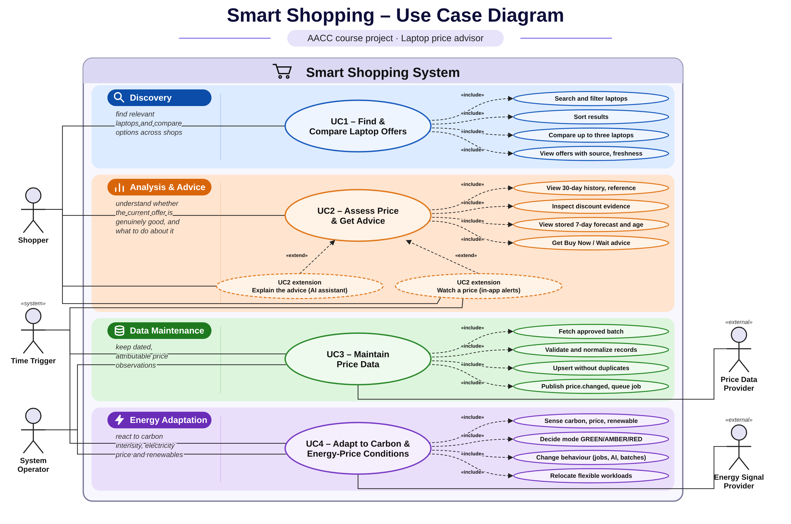

UC2 accepts an optional budget and brand preferences and then offers alternatives. Its two extensions are "explain in natural language" (the AI assistant, sequence ASUC-02) and "watch a price" (a device-scoped target price, a scheduled check and in-app alerts without email or push, sequence SQ-02). UC4 senses carbon intensity, electricity price and renewable availability, decides an operating mode and lets forecasts, AI routing, optional batches and workload placement adapt; the operator tunes the policy at runtime. The figure shows the four use cases with their included steps; [use-case.puml](diagrams/use-case.puml) is the UML model of the same four use cases and two extensions, and the editable figure is [use-case.svg](diagrams/use-case.svg).

## Selection

| Use case | Significant? | Reason |
| --- | --- | --- |
| UC1 Find and compare laptop offers | No | An indexed read-only query over a small catalog. It forces no new component, interface or quality trade-off, so it has no sequence diagram. |
| UC2 Assess a laptop's price and get advice | Yes (ASUC-01) | Forces the read path, the separation of stored forecasts from request time, and the evidence states. |
| UC2 extension: explain in natural language | Yes (ASUC-02) | Introduces an LLM component and the whole harness around it: routing, guardrails, memory, cache, tracing, human review. |
| UC3 Maintain price data | Yes (ASUC-03) | Forces data integrity, idempotent writes, provenance and the link between new data and forecast jobs. |
| UC4 Adapt operation to carbon and energy-price conditions | Yes (ASUC-04) | Forces a sensing component, a policy component, runtime configuration, an event bus, a defined behaviour change in several consumers and a placement mechanism that moves workloads. |

## ASUC-01 - Assess a laptop's price and get advice

**Actor / trigger:** Shopper opens a laptop.  
**Goal:** Show current offers, the 30-day history and reference, the stored forecast and a checkable recommendation together.

**Normal flow** (numbers refer to the sequences [03-analysis](diagrams/03-analysis.png) for steps 1 to 3 and 6 and [04-recommendation](diagrams/04-recommendation.png) for steps 4 and 5):
1. The client asks the Shopping API for the laptop's insights (03-analysis, 02).
2. Price Evidence reads current offers and 30 days of observations, derives the daily lowest valid offer, the reference and the delta, and marks the evidence sufficient or insufficient (03-analysis, 03-10).
3. The Forecast Service reads the latest stored forecast and compares its age with the freshness limit (03-analysis, 11-15).
4. The Advice Engine applies the rules, then the optional budget and brand constraints, and returns the action, reasons, caveats and whether alternatives are needed (04-recommendation, 03-12).
5. If the budget or a brand preference is not met, the API asks Catalog Query for up to three alternatives within the constraints (04-recommendation, 13-17).
6. The API assembles Past, Present, Future and alternatives with timestamps and sources and returns them (03-analysis, 16-18; 04-recommendation, 18-19).

**Alternatives:** too few observation days → evidence marked insufficient and the action is Insufficient Evidence; forecast stale or missing → rules use the delta only and add a caveat; best offer above the budget → Buy Now is withheld (Wait, reason "above your budget") and alternatives are offered.  
**Preconditions:** The laptop exists. History and forecast may be incomplete.  
**Postconditions:** Observed prices and estimates are distinguished, dated and sourced.  
**Quality drivers:** NFR-01 (latency), NFR-04 (fault tolerance), NFR-07 (modifiability).  
**Decisions it forces:** [ADR-001](adr/ADR-001.md), [ADR-003](adr/ADR-003.md), [ADR-006](adr/ADR-006.md), [ADR-010](adr/ADR-010.md).  
**Requirements:** FR-02, FR-03, FR-04, FR-07, FR-22.

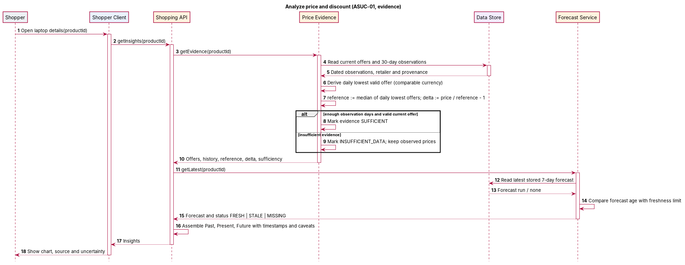

No forecast is computed during this request; the stored forecast is read and labelled with its age (ADR-006).

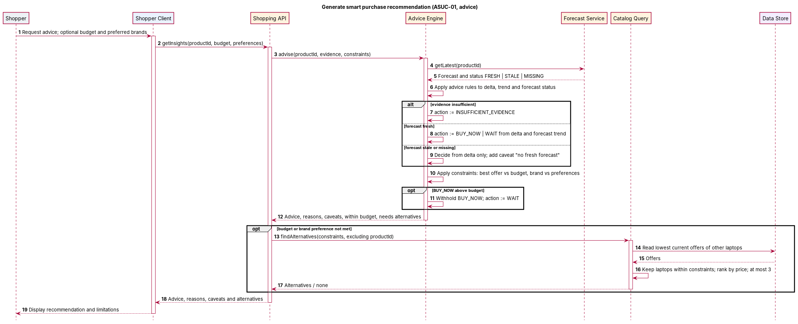

Advice is rule-based, not a guarantee of future prices; a stale forecast is never treated as fresh.

## ASUC-02 - Explain the advice with the AI assistant

**Actor / trigger:** Shopper asks a question about a laptop (extension of UC2).  
**Goal:** Explain the rule-based advice in natural language without inventing facts.

**Normal flow** (numbers refer to the [sequence 07-ai-explanation](diagrams/07-ai-explanation.png)):
1. The Assistant Service obtains the evidence and the advice, builds a structured evidence payload and hashes it (03-07).
2. The Input Guardrail checks size and scope and treats product and retailer text as data (09); an out-of-scope request is refused from a template (10).
3. The LLM Gateway looks in the cache (11-12), reads the operating mode (13-14) and decides the route (15): cache, template, small local or large external model. No tools or agent loop are used.
4. For a model route, the gateway applies a value and cost gate (15) and sends the prompt to the local small model (17-18) or the external large model (19-20); the Output Guardrail checks the draft (21). A rejected draft is retried once with the error message; if it fails again, the template answer is used and the exchange is flagged (22).
5. The gateway writes the trace and returns the answer with a disclosure label (23-26). Storing the answer and the session turn is described in [ai-architecture.md](ai-architecture.md).

**Alternatives:** out-of-scope input → refusal from a template; insufficient evidence or RED mode → template without a model call; provider outage → template.  
**Preconditions:** Evidence and advice exist or are explicitly insufficient.  
**Postconditions:** The answer matches the rule result and the evidence; every exchange is traced; flagged exchanges wait for operator review.  
**Quality drivers:** NFR-04, NFR-06, NFR-11 (groundedness), NFR-14 (AI traceability), NFR-13.  
**Decisions it forces:** [ADR-007](adr/ADR-007.md), [ADR-004](adr/ADR-004.md), [ADR-006](adr/ADR-006.md).  
**Requirements:** FR-08, FR-17.

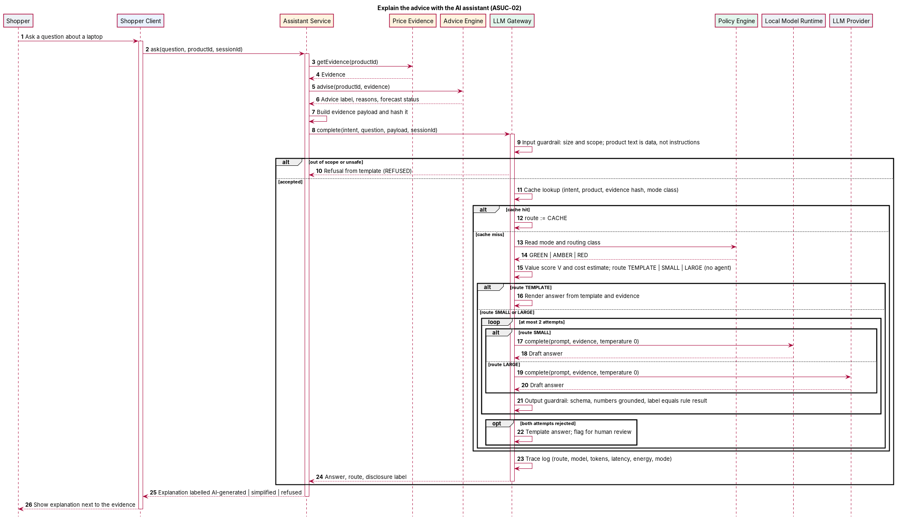

LARGE (external) is used only in GREEN mode or after a failed check; flagged exchanges go to the operator review queue.

## ASUC-03 - Maintain price data

**Actor / trigger:** Time trigger starts an import from an approved source; the operator reads the report.  
**Goal:** Keep dated, attributable observations without duplicates and make new data available to forecasting.

**Normal flow** (numbers refer to the [sequence 01-import](diagrams/01-import.png)):
1. The importer reads the operating mode and selects batches: the mandatory daily batch always runs, optional backfills only in GREEN (02-04).
2. It fetches the batch (05-06), stores it unchanged in the raw layer (07), and validates and normalizes each record (08-10).
3. Accepted records are upserted on the stable observation identity (11-12).
4. The import report is written and a `price.changed` event is published (13-14); import metrics are described in [observability.md](observability.md).
5. The Job Scheduler, subscribed to the event, enqueues or keeps a forecast job for each changed laptop; an existing deadline is never reset and a duplicated event creates no second job (15-16).

**Alternatives:** provider unavailable → the failed run is recorded and existing observations stay visible with their age (17); invalid records → listed with reasons (10).  
**Preconditions:** Catalog entries, retailer mappings and source configuration exist.  
**Postconditions:** Valid observations stored once; repeating the batch inserts nothing new.  
**Quality drivers:** NFR-05, NFR-08, NFR-03 (job deadline starts here), NFR-19 (event delivery).  
**Decisions it forces:** [ADR-002](adr/ADR-002.md), [ADR-005](adr/ADR-005.md), [ADR-012](adr/ADR-012.md).  
**Requirements:** FR-09, FR-10, FR-19.

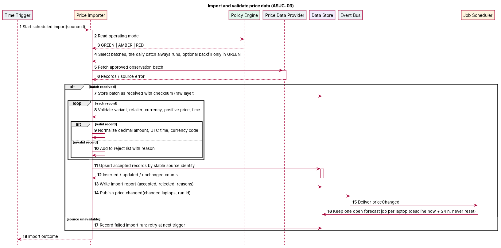

A failed import leaves stored observations intact. Repeating a batch inserts nothing new; a duplicate event creates no second job.

## ASUC-04 - Adapt operation to carbon and energy-price conditions

**Actors / triggers:** Time trigger (every 5 minutes for sensing, deciding and placement reconciliation, every 15 minutes for job scheduling); the operator configures the policy; the energy signal provider supplies carbon intensity, price and the renewable flag.  
**Goal:** Let the application be *aware* of the energy signals and *change its own behaviour, configuration and placement*, while keeping the freshness deadline.

The use case has three concerns. The overview sequence [06-carbon](diagrams/06-carbon.png) shows all of them in one picture (sense 01-05, decide 06-13, notify 14-15, act through the Job Scheduler 16-24, place workloads 25-28); the three detailed sequences below, kept in `docs/diagrams/detail`, add the operator configuration, the AI routing, the optional batches, the feedback and the safety checks of the placement.

**ASUC-04a - configure, sense, decide** ([sequence](diagrams/detail/sequence-carbon-decide.png)):
1. The operator edits the policy; the Policy Engine validates it and stores a new versioned policy with an audit record (01-06).
2. The Carbon Monitor fetches the signals, validates each value and stores the sample, or stores a MISSING sample (07-14).
3. The Policy Engine loads the policy and the latest two samples, falls back to GREEN behaviour if the signal is stale, classifies intensity and price with hysteresis, takes the more restrictive class, lets renewable energy force GREEN, applies any override, persists a mode change with its reason and placement target and publishes `mode.changed` (15-28).

**ASUC-04b - act and feedback** ([sequence](diagrams/detail/sequence-carbon-act.png)):
1. The event bus tells the Job Scheduler and the Model Router about the new mode; the router drops cache entries of the wrong lifetime class (01-03).
2. The Job Scheduler reads the mode, claims due jobs with a lease and decides per job: deadline reached, run; GREEN, run; AMBER, run only if at most half of the window remains; otherwise defer (04-09).
3. The Forecast Worker predicts through the adapter, a sanity check protects the stored forecast, and the scheduler estimates kWh and gCO2e (10-19); a deferral releases the lease (20); the decision is logged (21-22).
4. The Model Router and the optional batches read the same mode and change their behaviour (23-29).
5. Metrics and execution logs let the operator compare with the immediate-run baseline through the console (30-33).

**ASUC-04c - relocate flexible workloads** ([sequence](diagrams/detail/sequence-carbon-place.png)):
1. The Placement Controller is triggered by the `mode.changed` event or by its periodic reconcile, which repairs a lost event (01-02).
2. It reads the mode and its placement target, lists the nodes and runs the safety checks: both pools have a ready node, the dwell time has passed and the change would not leave zero schedulable nodes (03-08).
3. If a check fails or nothing changes, it records the decision as skipped (09-10). Otherwise it taints the non-target pool, Kubernetes evicts and reschedules the flexible pods, and the decision is recorded and reported (11-15).

**Alternatives:** signal missing for longer than the stale limit, GREEN behaviour with reason `signal_stale`; one of two signals missing, the other decides; worker failure, the previous forecast stays visible with its age and the job is retried before its deadline; operator override, the override mode until it expires; event lost, the periodic pull and the placement reconcile repair it.  
**Postconditions:** Every decision, mode change and placement change is recorded with timing, reason and status; no job is intentionally deferred beyond its deadline. A deadline forces an attempt, not a guaranteed success.  
**Quality drivers:** NFR-02, NFR-03, NFR-10, NFR-13, NFR-16, NFR-19, NFR-20.  
**Decisions it forces:** [ADR-004](adr/ADR-004.md), [ADR-005](adr/ADR-005.md), [ADR-008](adr/ADR-008.md), [ADR-012](adr/ADR-012.md), [ADR-013](adr/ADR-013.md).  
**Requirements:** FR-11, FR-12, FR-13, FR-14, FR-15, FR-16, FR-18, FR-19, FR-20.

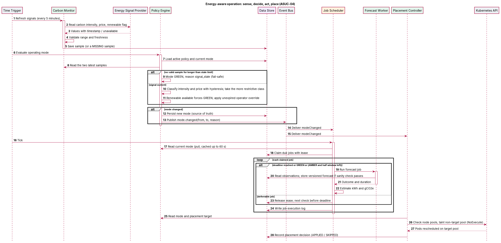

Thresholds are demonstration values. The database is the source of truth; a lost event is repaired by the next pull. A 24 h deadline always wins; request-path pods, database and event bus never move. Savings are measured, not assumed.

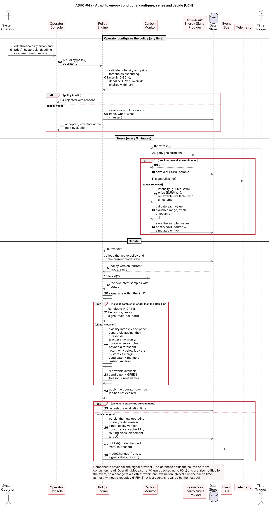

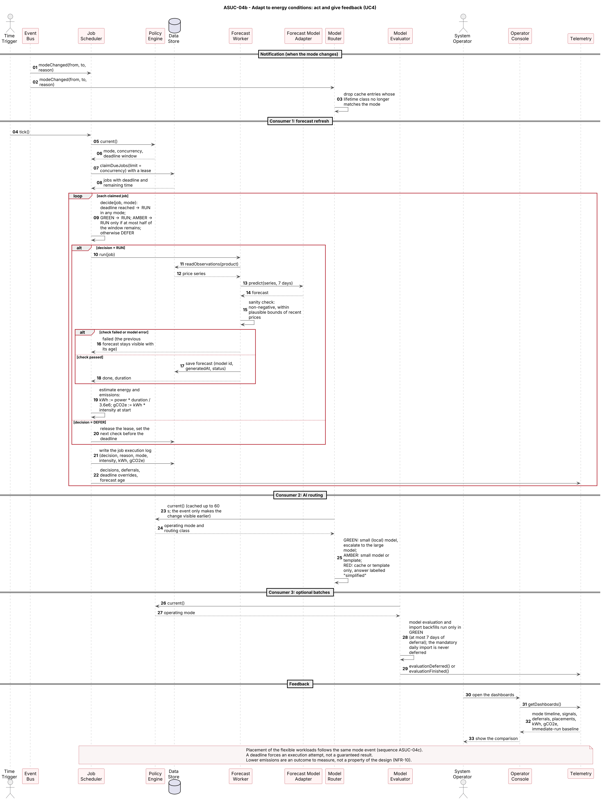

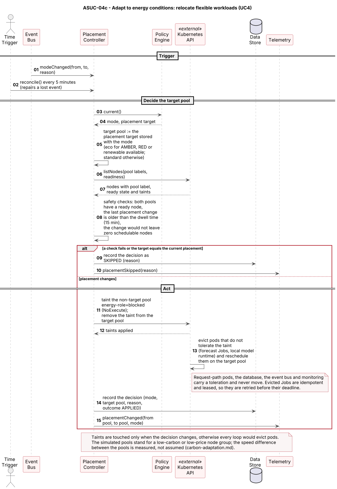

## Supplementary sequences (use cases that are not significant)

These two sequences were added when the supplied sequence diagrams were compared with the project; in revision 7 they were redrawn in the style of the supplied set. They use the component names of the component model, numbered messages and self-calls, like the others.

| Sequence | Use case | Why it is not significant | What it shows |
| --- | --- | --- | --- |
| [SQ-01](diagrams/02-compare.puml) ([image](diagrams/02-compare.png)) | UC1 Find and compare laptop offers | Read-only and forces no new component | Validation, search, grouping of exact variants, stale flags, the side-by-side table (FR-05) and the empty result with suggested filter changes. |
| [SQ-02](diagrams/05-monitoring.puml) ([image](diagrams/05-monitoring.png)) | UC2 extension: watch a price | One small module that follows the scheduled-job and idempotence pattern of ASUC-03 and ASUC-04b | Saving a watch, the 30-minute check, one alert per episode with a deduplication key in one transaction, stale data ignored, in-app alert list ([ADR-017](adr/ADR-017.md), FR-06). |

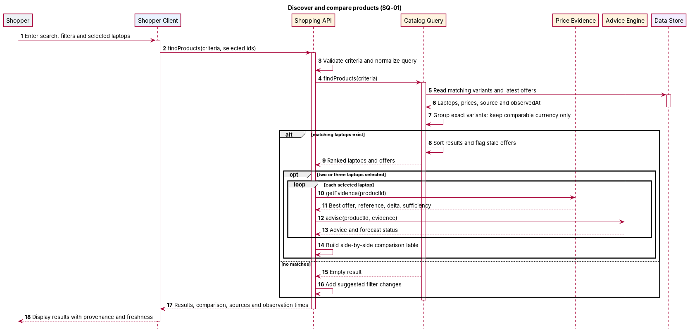

Only exact variants and comparable currencies are compared. The sequence is read-only.

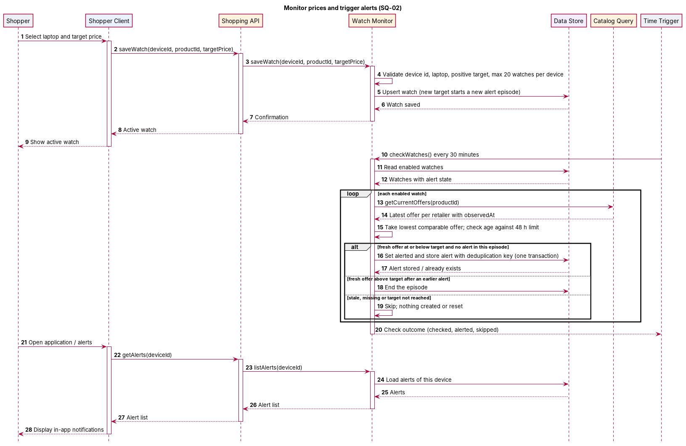

Device-scoped, pseudonymous watchlist (ADR-017, proposed); no account, email or push delivery. Stale data never creates or resets an alert.
